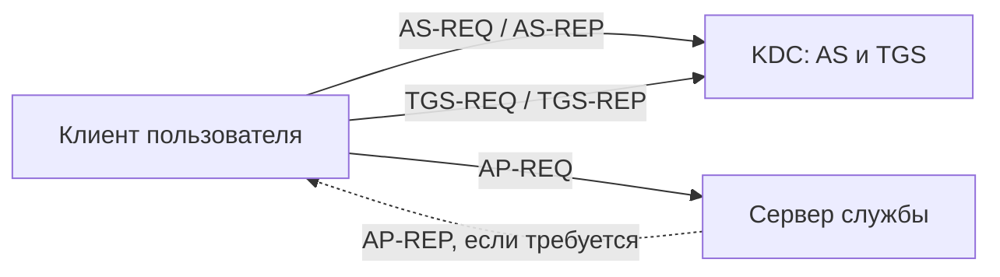
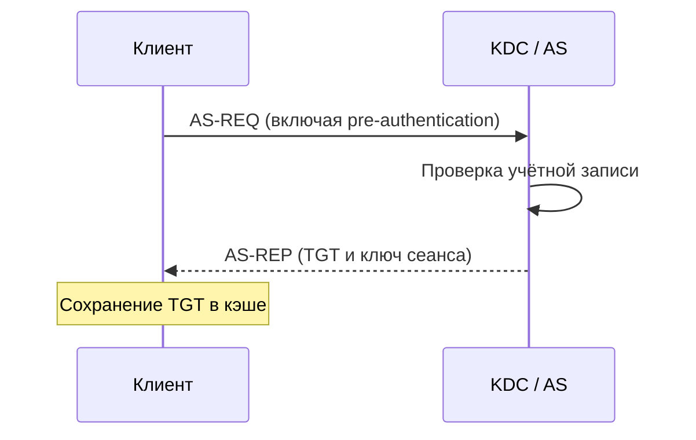
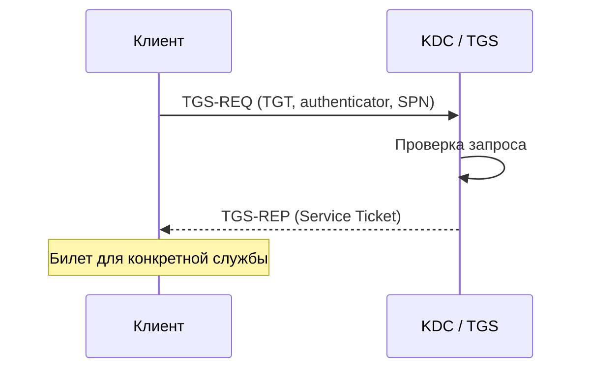
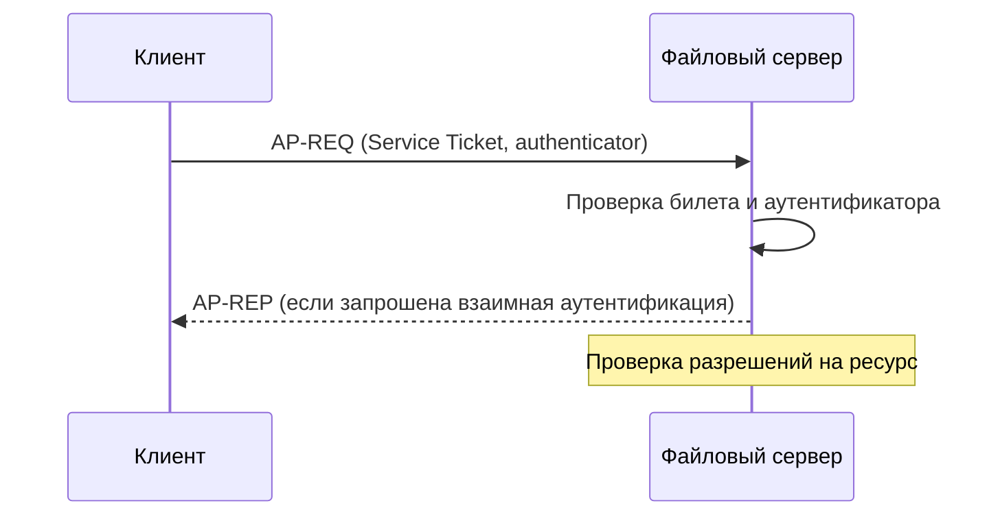
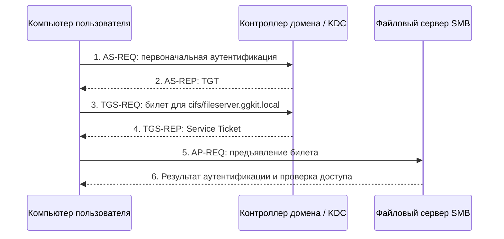

## 1. Назначение Kerberos

**Kerberos** — сетевой протокол аутентификации, позволяющий пользователю или службе подтверждать свою подлинность при обращении к другим службам без повторной передачи пароля каждой из них.

Kerberos применяется в Active Directory, Samba AD DC и других инфраструктурах. Его основа — **билеты (tickets)**, которые выдаёт доверенный центр аутентификации.

Пример: пользователь вошёл на доменный компьютер, а затем открыл общую папку файлового сервера. При корректной настройке Kerberos сервер может проверить билет пользователя, не запрашивая пароль повторно.

> [!INFO] Аутентификация и авторизация
> **Аутентификация** — подтверждение того, кто обращается к службе. **Авторизация** — определение доступных действий. Kerberos прежде всего решает задачу аутентификации; доступ к файлам, ресурсам и операциям определяется дополнительными механизмами, например ACL.

## 2. Основные компоненты Kerberos

- **Principal** — идентификатор участника Kerberos: пользователя или службы. Примеры: `student@GGKIT.LOCAL`, `HTTP/web.ggkit.local@GGKIT.LOCAL`.
- **Realm** — область доверия Kerberos, в которой действует центр выдачи билетов. В доменной инфраструктуре обычно соответствует DNS-имени домена, записанному заглавными буквами: `GGKIT.LOCAL`.
- **KDC (Key Distribution Center)** — центр распределения ключей, который проверяет участников и выдаёт билеты.
- **AS (Authentication Service)** — часть KDC, выдающая первоначальный билет TGT.
- **TGS (Ticket Granting Service)** — часть KDC, выдающая билеты для конкретных служб.
- **TGT (Ticket Granting Ticket)** — билет для обращения к TGS за билетами служб.
- **Service Ticket** — билет для доступа к определённой службе.
- **Session Key** — временный ключ, используемый в конкретном обмене.

В Active Directory роль KDC выполняют контроллеры домена. Это не отдельный обязательный сервер.



## 3. Для чего нужны два типа билетов

**TGT** подтверждает, что пользователь уже прошёл первоначальную аутентификацию перед KDC. Его нельзя использовать как обычный билет доступа к произвольному файловому или веб-серверу.

**Service Ticket** предназначен конкретной службе. Например, билет для `cifs/fileserver.ggkit.local` используется при обращении к файловому серверу по SMB.

Разделение позволяет один раз пройти первоначальную аутентификацию и затем получать билеты для разных служб без повторного ввода пароля.

| Билет | Кем выдаётся | Для чего используется |
|---|---|---|
| TGT | AS | Для запроса билетов служб у TGS |
| Service Ticket | TGS | Для аутентификации перед конкретной службой |

> [!IMPORTANT] Билет не равен паролю
> Билеты имеют ограниченный срок действия и защищены криптографически. Однако похищенный действующий билет может представлять угрозу: его необходимо защищать так же внимательно, как другие данные аутентификации.

## 4. Первоначальная аутентификация — AS Exchange

Первый этап — получение TGT.

1. Клиент определяет, к какому KDC обращаться.
2. Клиент отправляет **AS-REQ** — запрос на первоначальную аутентификацию.
3. В типичном сценарии используется **pre-authentication**: клиент доказывает знание ключа, связанного с учётной записью, например посредством зашифрованной временной метки.
4. KDC проверяет данные и отправляет **AS-REP**, содержащий TGT и информацию для клиента.
5. Клиент сохраняет полученный TGT в кэше билетов.



Пароль не отправляется серверу в открытом виде. При парольной аутентификации клиент использует ключ, производный от пароля, а KDC располагает соответствующими ключевыми данными учётной записи.

**Важно:** упрощённая схема показывает распространённый сценарий с паролем. В Kerberos возможны другие способы предварительной аутентификации, например с сертификатами (PKINIT).

## 5. Получение билета службы — TGS Exchange

Когда пользователь обращается к сетевой службе, клиенту требуется отдельный Service Ticket.

1. Клиент определяет имя службы — **SPN (Service Principal Name)**.
2. Отправляет KDC запрос **TGS-REQ**, используя ранее полученный TGT и аутентификатор.
3. KDC проверяет запрос и выдаёт **TGS-REP** с билетом для нужной службы.
4. Клиент сохраняет Service Ticket и использует его при подключении к серверу.



Например, при обращении к `\\fileserver.ggkit.local\shared` клиент может запросить билет для `cifs/fileserver.ggkit.local`.

## 6. Аутентификация перед службой — AP Exchange

После получения Service Ticket клиент обращается непосредственно к серверу службы.

1. Клиент передаёт серверу **AP-REQ**: билет службы и аутентификатор.
2. Сервер расшифровывает предназначенную ему часть билета своим ключом и проверяет данные.
3. При необходимости сервер отвечает **AP-REP**, подтверждая собственную подлинность (взаимная аутентификация).
4. После успешной аутентификации служба отдельно проверяет права пользователя.



> [!TIP] Почему пароль не нужен при каждом подключении
> Клиент уже имеет TGT, получает Service Ticket у KDC и предъявляет его службе. Сама служба не должна получать пароль пользователя для выполнения обычной Kerberos-аутентификации.

## 7. Полный процесс на одном примере

Пользователь `student@GGKIT.LOCAL` входит в домен и открывает папку на сервере `fileserver.ggkit.local`.



В этом примере **KDC подтверждает личность и выдаёт билеты**, а **файловый сервер принимает решение о доступе к конкретной папке**.

## 8. SPN и учётные записи служб

**SPN (Service Principal Name)** — имя, по которому Kerberos различает службы и находит учётную запись, связанную с нужной службой.

Примеры:

- `cifs/fileserver.ggkit.local` — файловый доступ SMB.
- `HTTP/portal.ggkit.local` — веб-служба с Kerberos-аутентификацией.
- `host/server01.ggkit.local` — типовой идентификатор службы хоста.

В Active Directory SPN хранится в атрибуте `servicePrincipalName` соответствующей учётной записи. Ошибки SPN, дублирующиеся SPN и несовпадение ключей могут приводить к отказу Kerberos-аутентификации.

> [!WARNING] Имя сервера имеет значение
> Подключение по IP-адресу или по имени, для которого не настроен подходящий SPN, может помешать использованию Kerberos. Некоторые приложения в таком случае переходят к другому механизму аутентификации, если он разрешён.

## 9. Ключи, время и срок действия билетов

Kerberos использует симметричную криптографию для защиты билетов и аутентификаторов. KDC и службы располагают ключевыми данными, необходимыми для проверки предназначенных им билетов.

**Почему важно время:** аутентификаторы содержат временную информацию для защиты от повторного воспроизведения запросов. Значительное расхождение часов клиента, KDC и сервера может приводить к ошибкам. В Active Directory типичный допустимый перекос времени — около пяти минут, но точное значение зависит от политики и конфигурации.

Билеты действуют ограниченное время; TGT в некоторых конфигурациях можно продлевать. Конкретные сроки задаются политиками домена или Kerberos.

Основные условия корректной работы:

- Синхронизированное время на клиентах, контроллерах домена и серверах.
- Корректное разрешение DNS-имён и обнаружение KDC.
- Правильные SPN и ключи учётных записей служб.
- Доступность необходимых сетевых портов, обычно TCP/UDP 88 для Kerberos.

## 10. Kerberos, LDAP и DNS — различия

| Компонент | Основная задача | Пример |
|---|---|---|
| **DNS** | Поиск контроллера домена и служб по именам | SRV-записи для обнаружения KDC |
| **LDAP** | Чтение и изменение объектов каталога | Поиск пользователя и его групп |
| **Kerberos** | Аутентификация с помощью билетов | Вход на файловый сервер без повторного ввода пароля |

Эти технологии дополняют друг друга, но не являются взаимозаменяемыми.

Например, приложение может найти контроллер домена через DNS, получить билет Kerberos, а затем обратиться к каталогу по LDAP с использованием Kerberos-аутентификации через SASL/GSSAPI.

## 11. Просмотр билетов и базовая диагностика

### 11.1. Linux

При установленном клиентском наборе Kerberos доступны команды:

```bash
kinit student@GGKIT.LOCAL
```

**`kinit`** — получение первоначальных Kerberos-учётных данных (обычно TGT). При парольном способе аутентификации команда запрашивает пароль.

```bash
klist
```

**`klist`** — просмотр текущих билетов в кэше, их времени выдачи и окончания действия.

```bash
kdestroy
```

**`kdestroy`** — удаление билетов из текущего кэша.

> [!INFO] Условия выполнения
> Команды предполагают, что Kerberos-клиент установлен, DNS и параметры realm настроены, а KDC доступен. Для Linux в домене AD могут применяться также `SSSD`, `realmd` и `adcli`; их настройка рассматривается в отдельных заметках.

### 11.2. Windows

```powershell
klist
```

Просмотр Kerberos-билетов текущего сеанса.

```powershell
klist purge
```

Очистка билетов текущего контекста входа. После очистки приложениям может потребоваться повторная аутентификация.

### 11.3. Типичные неисправности

| Признак | Возможная причина | Направление проверки |
|---|---|---|
| KDC недоступен | DNS или сеть | SRV-записи, разрешение имён, TCP/UDP 88 |
| Билет ещё не действителен или отклонён по времени | Рассинхронизация часов | NTP и системное время |
| Ошибка `KRB_AP_ERR_MODIFIED` | Неверный SPN или ключ службы | SPN, учётная запись службы, keytab |
| Билет есть, но доступ запрещён | Недостаточно прав | ACL, группы, политики доступа |
| При подключении используется не Kerberos | Неверное имя службы или настройки приложения | SPN, DNS-имя, параметры аутентификации |

> [!DANGER] Осторожность при диагностике
> Не публиковать файлы keytab, кэши билетов, пароли и диагностические дампы с секретами. Очистка билетов и изменение SPN на рабочих системах могут прервать действующие подключения.

## 12. Ограничения и безопасность

Kerberos не обеспечивает автоматически безопасность всей доменной инфраструктуры. Его надёжность зависит от защиты учётных записей, ключей служб, контроллеров домена и клиентских устройств.

Основные риски:

- **Компрометация билетов** — злоумышленник может попытаться использовать похищенные действующие учётные данные.
- **Слабые пароли служебных учётных записей** — повышают риск атак на билеты служб.
- **Неправильная настройка SPN** — приводит к ошибкам аутентификации и нежелательному переключению на другие протоколы.
- **Компрометация KDC** — критична для доверия внутри realm.
- **Устаревшие алгоритмы шифрования** — требуют пересмотра настроек и совместимости клиентов.

Практические меры: ограничение привилегий служебных учётных записей, использование поддерживаемых алгоритмов, защита контроллеров домена, синхронизация времени, аудит событий аутентификации и своевременное обновление систем.

## Вопросы для самопроверки

1. Какую задачу решает Kerberos и чем она отличается от авторизации?
2. Что такое KDC, AS и TGS?
3. Чем TGT отличается от Service Ticket?
4. В какой последовательности выполняются AS, TGS и AP Exchange?
5. Для чего используется SPN?
6. Почему Kerberos зависит от синхронизации времени?
7. Как связаны Kerberos, LDAP и DNS в доменной инфраструктуре?
8. Что показывают команды `kinit` и `klist`?

## Итоги — что было разобрано

- Kerberos выполняет сетевую аутентификацию с помощью билетов.
- KDC выдаёт TGT и билеты конкретных служб.
- Процесс включает AS Exchange, TGS Exchange и AP Exchange.
- SPN связывает запрос билета с определённой службой.
- DNS, корректное время и защита ключей необходимы для устойчивой работы.
- Kerberos подтверждает подлинность, а права доступа проверяются отдельно.

## Связанные заметки

- [[Synced/DevOps/Сетевое и системное администрирование/3. Доменная инфраструктура/0. Основы доменной инфраструктуры/1. Назначение и архитектура домена.md|Назначение и архитектура домена]]
- [[Synced/DevOps/Сетевое и системное администрирование/3. Доменная инфраструктура/0. Основы доменной инфраструктуры/2. Active Directory — объекты, структура и службы.md|Объекты, структура и службы Active Directory]]
- [[Synced/DevOps/Сетевое и системное администрирование/3. Доменная инфраструктура/0. Основы доменной инфраструктуры/3. LDAP — каталоги, DN, атрибуты и запросы.md|LDAP — каталоги, DN, атрибуты и запросы]]
- [[Synced/DevOps/Сетевое и системное администрирование/3. Доменная инфраструктура/0. Основы доменной инфраструктуры/5. DNS, SRV-записи и обнаружение контроллеров.md|DNS, SRV-записи и обнаружение контроллеров]]

---

## Теги

#devops #domain-infrastructure #active-directory #kerberos #kdc #authentication #tgt #service-ticket #spn #sso #ldap #dns #security #windows-server #samba-ad
