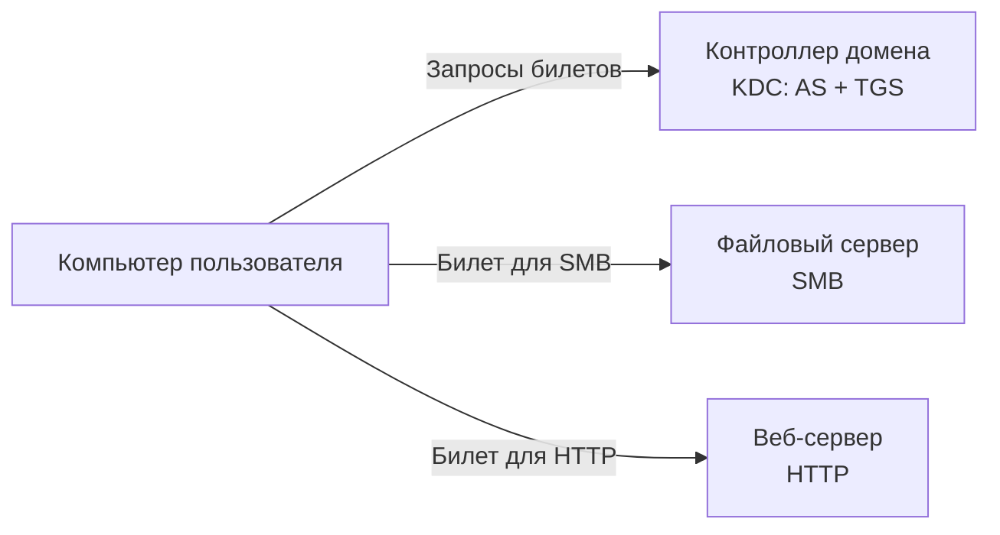
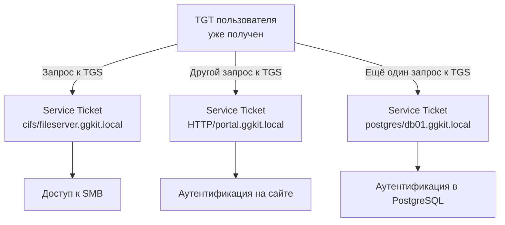
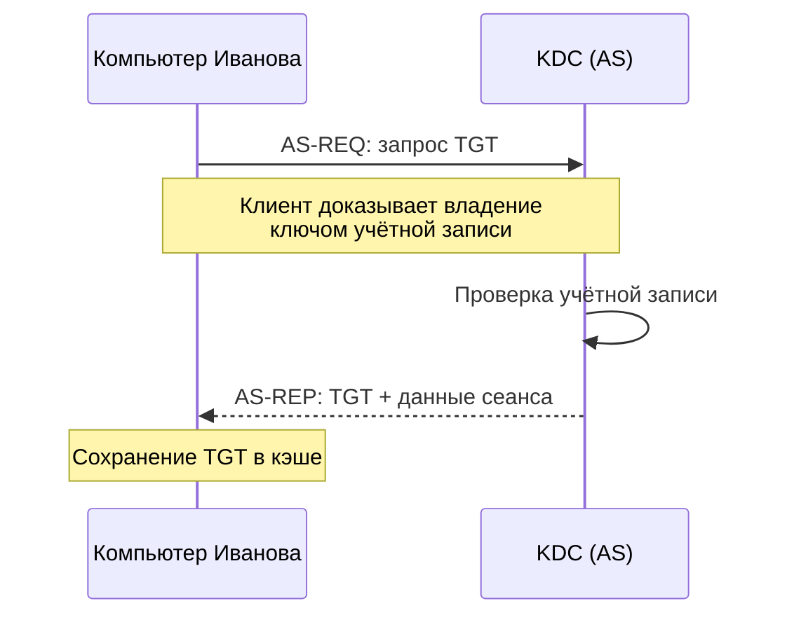
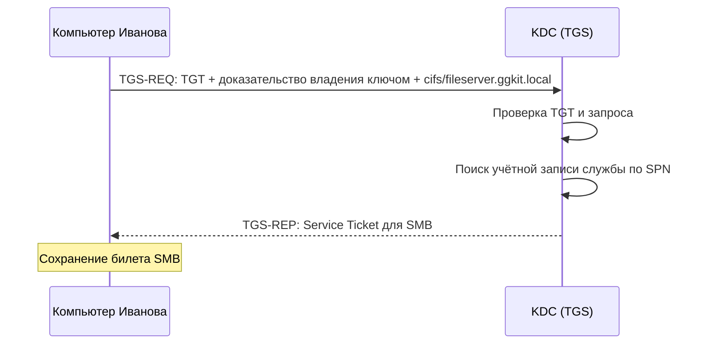
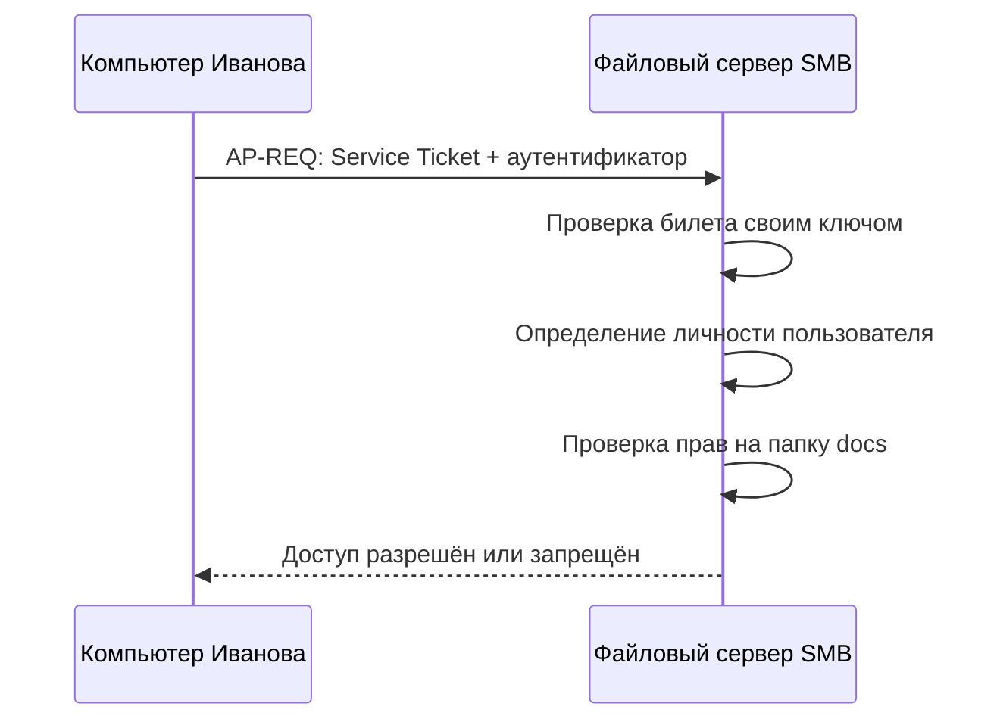
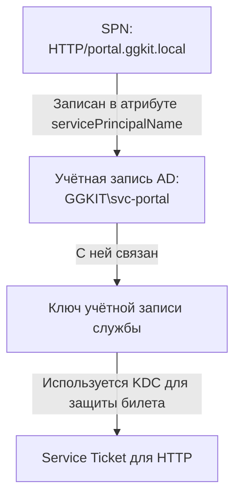
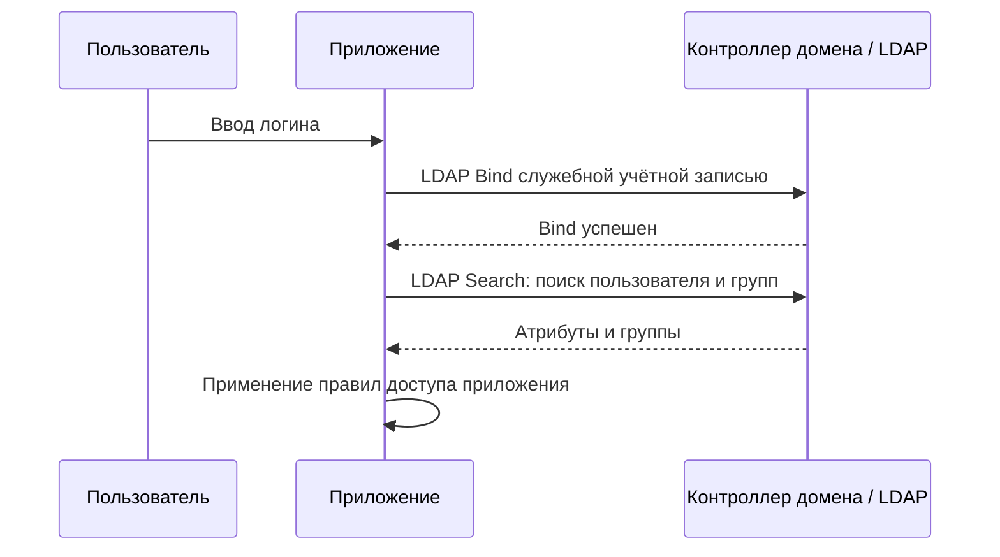
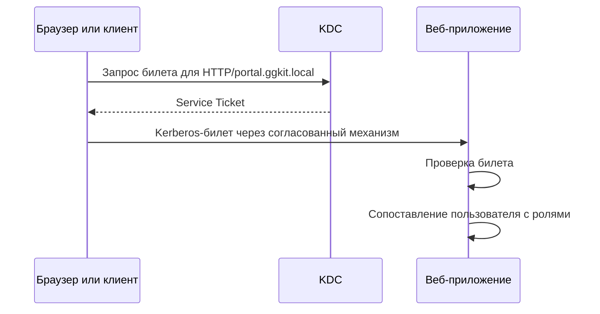
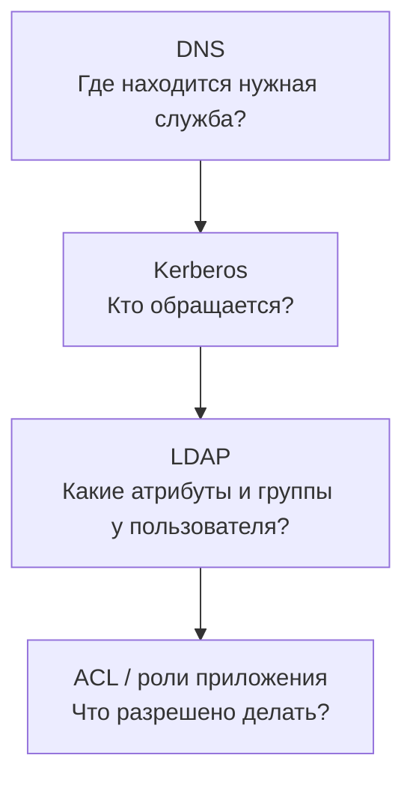

## 1. Назначение Kerberos

**Kerberos** — протокол сетевой аутентификации, позволяющий подтвердить личность пользователя или службы с помощью временных **билетов (tickets)**.

Основная задача — дать пользователю возможность обращаться к нескольким доменным службам **без повторной передачи своего пароля каждой службе**.

Пример: пользователь `ivanov` вошёл в доменный компьютер и затем открыл сетевую папку `\\fileserver.ggkit.local\docs`. Компьютер может автоматически получить нужный билет Kerberos и предъявить его файловому серверу.

> [!INFO] Аутентификация и авторизация
> **Аутентификация** — установление личности: «Это действительно Иванов?»
>
> **Авторизация** — проверка прав: «Может ли Иванов читать или изменять эту папку?»
>
> Kerberos отвечает прежде всего за **аутентификацию**. Права на папки, DNS-зоны, объекты каталога и другие ресурсы проверяют соответствующие службы.

### 1.1. Какие проблемы решает Kerberos

- Отсутствие необходимости передавать пароль каждому серверу.
- Единый механизм аутентификации для доменных служб.
- Возможность взаимной аутентификации клиента и сервера.
- Ограниченное время действия билетов.

**Kerberos не является каталогом пользователей.** Он не предназначен для поиска атрибутов учётных записей или изменения групп. Для работы с каталогом обычно используется LDAP.

## 2. Участники Kerberos

| Термин | Значение |
|---|---|
| **Клиент** | Пользовательское приложение или компьютер, которому нужен доступ к службе |
| **Служба** | SMB, HTTP, PostgreSQL или другая служба, принимающая Kerberos-аутентификацию |
| **KDC** | Key Distribution Center — центр выдачи билетов |
| **AS** | Authentication Service — часть KDC для первоначальной аутентификации |
| **TGS** | Ticket Granting Service — часть KDC для выдачи билетов конкретным службам |
| **Realm** | Область Kerberos, например `GGKIT.LOCAL` |
| **Principal** | Идентификатор участника Kerberos, например `ivanov@GGKIT.LOCAL` |
| **TGT** | Ticket Granting Ticket — билет для обращения к TGS |
| **Service Ticket** | Билет для конкретной службы |

В домене Samba AD или Microsoft AD роль KDC обычно выполняет **контроллер домена**. AS и TGS — логические части KDC, а не обязательно два отдельных сервера.



**Пояснение к схеме:**

1. Компьютер пользователя обращается к KDC, когда ему необходимы билеты.
2. KDC выдаёт билеты, но **не пересылает каждое обращение пользователя к службе**.
3. Получив нужный билет, клиент обращается непосредственно к файловому или веб-серверу.
4. Для разных служб обычно используются разные Service Tickets.

## 3. Почему нужны TGT и Service Ticket

Это ключевая часть работы Kerberos.

### 3.1. TGT — билет для получения других билетов

После первоначального входа клиент получает **TGT**. Он предназначен **не для доступа к файловому серверу, PostgreSQL или сайту**, а для последующих обращений к **TGS**.

Представим, что пользователь вошёл в домен. Его компьютер сохранил TGT. Теперь пользователь открывает сетевую папку. Компьютер предъявляет TGT контроллеру домена и запрашивает **отдельный билет для SMB**.

Затем пользователь открывает корпоративный сайт. Компьютер использует **тот же действующий TGT**, чтобы запросить **другой билет для HTTP**.

Таким образом, TGT позволяет не проходить первоначальную аутентификацию заново при каждом обращении к новой службе.

> [!IMPORTANT] TGT не является универсальным пропуском
> Файловый сервер не принимает TGT вместо билета для SMB. TGT нужен для общения с TGS, а Service Ticket — для общения с конкретной службой.

### 3.2. Service Ticket — билет для конкретной службы

**Service Ticket** выдаётся для определённого идентификатора службы, например:

- `cifs/fileserver.ggkit.local` — SMB;
- `HTTP/portal.ggkit.local` — веб-приложение;
- `postgres/db01.ggkit.local` — PostgreSQL, если настроена Kerberos-аутентификация.

Service Ticket содержит сведения, позволяющие службе проверить аутентификацию клиента. Защищённая часть билета зашифрована ключом, связанным с учётной записью службы.

### 3.3. Один TGT — несколько билетов служб



**Пояснение к схеме:**

1. У пользователя уже имеется **один действующий TGT**.
2. При первом обращении к каждой новой службе клиент запрашивает у TGS билет именно для неё.
3. Билет для SMB не предназначен для HTTP или PostgreSQL.
4. Полученные Service Tickets могут сохраняться в кэше и использоваться повторно до истечения срока действия.
5. Наличие билета ещё **не означает**, что пользователь получит права на нужный ресурс.

## 4. Полный процесс на примере сетевой папки

Пользователь `ivanov@GGKIT.LOCAL` открывает `\\fileserver.ggkit.local\docs`.

Разделим процесс на три этапа.

### 4.1. Этап 1. Первоначальная аутентификация и получение TGT



**Пояснение:**

1. Клиент отправляет `AS-REQ` — запрос первоначальной аутентификации.
2. В распространённом варианте с предварительной аутентификацией клиент доказывает знание ключа, полученного из пароля. Сам пароль не передаётся серверу в открытом виде.
3. KDC проверяет доказательство и выдаёт `AS-REP`.
4. Клиент получает TGT и соответствующий ключ сеанса, необходимый для последующих запросов.
5. TGT сохраняется в кэше билетов.

**Что находится внутри TGT?** В упрощённом виде — данные о клиенте, сроках действия и ключе сеанса. Сам TGT защищён ключом службы выдачи билетов (`krbtgt` в AD). Клиент не может произвольно менять его содержимое.

### 4.2. Этап 2. Получение Service Ticket с помощью TGT



**Пояснение:**

1. Компьютер определяет, что для подключения к папке нужен билет `cifs/fileserver.ggkit.local`.
2. Он отправляет TGT и **аутентификатор** (криптографическое доказательство владения ключом сеанса) в запросе `TGS-REQ`.
3. KDC проверяет действительность TGT и аутентификатора.
4. KDC определяет, какой учётной записи соответствует служба `cifs/fileserver.ggkit.local`.
5. KDC выдаёт Service Ticket, защищённый ключом этой службы.

**Зачем предъявлять TGT?** Чтобы TGS мог убедиться, что первоначальная аутентификация уже выполнена. Дополнительный аутентификатор нужен, чтобы одного украденного файла TGT было недостаточно для корректного запроса без соответствующего ключа сеанса.

### 4.3. Этап 3. Обращение к файловому серверу



**Пояснение:**

1. Компьютер отправляет билет **не KDC, а непосредственно файловому серверу**.
2. Файловый сервер проверяет билет с помощью своего ключа.
3. После подтверждения личности сервер проверяет ACL и другие правила доступа.
4. Даже действительный билет Иванова не даст ему доступ, если на папку нет необходимых разрешений.

При взаимной аутентификации сервер также может отправить `AP-REP` для подтверждения своей подлинности. Эта деталь опущена на схеме, чтобы не смешивать её с проверкой прав.

## 5. SPN — что это такое и чем он не является

**SPN (Service Principal Name)** — идентификатор службы в Kerberos. Он нужен, чтобы клиент и KDC могли определить, **для какой службы запрашивается билет** и **какая учётная запись владеет ключом этой службы**.

Типичная форма:

```text
тип_службы/имя_сервера
```

Например:

```text
cifs/fileserver.ggkit.local
HTTP/portal.ggkit.local
postgres/db01.ggkit.local
```

### 5.1. SPN — не отдельная учётная запись

Здесь важно разделить три понятия:

| Объект | Что означает | Пример |
|---|---|---|
| **SPN** | Имя службы для Kerberos | `HTTP/portal.ggkit.local` |
| **Учётная запись службы** | Доменная учётная запись, под которой работает служба или с ключом которой она связана | `GGKIT\svc-portal` |
| **Права учётной записи** | Разрешённые действия в системе или каталоге | Чтение LDAP-атрибутов, изменение определённых объектов |

**SPN не содержит права и не является «логином с разрешениями».** В Active Directory SPN обычно хранится как значение атрибута `servicePrincipalName` у учётной записи пользователя, компьютера или управляемой служебной учётной записи (gMSA).

### 5.2. Как SPN связан с учётной записью службы

Допустим, портал работает от доменной учётной записи `GGKIT\svc-portal`.

Администратор связывает с этой учётной записью SPN:

```text
HTTP/portal.ggkit.local
```



**Пояснение:**

1. SPN записан **у учётной записи**, а не существует как самостоятельный пользователь.
2. По SPN KDC находит соответствующую учётную запись.
3. Ключ этой учётной записи используется для защиты билета, который должна принять служба.
4. Служба должна располагать подходящим ключом — напрямую, через механизм ОС или через keytab.
5. Одна учётная запись может иметь несколько SPN. Но один и тот же SPN не должен конфликтно принадлежать нескольким учётным записям.

На Windows для служб, работающих от имени компьютера, SPN может принадлежать **учётной записи компьютера**, например `FILESERVER$`, без создания отдельного пользователя `svc-*`.

### 5.3. Пример с DNS и присоединением компьютера к домену

Предположение «SPN — это учётка с правом редактировать DNS или вводить компьютеры в домен» **неверно**.

- **SPN** идентифицирует службу, к которой обращается клиент.
- **Учётная запись** определяет, от чьего имени выполняется операция.
- **ACL и политики** определяют, можно ли менять DNS-зону, создавать объект компьютера или изменять другие объекты AD.

Например, для защищённого динамического обновления DNS важны аутентификация клиента и разрешения на запись DNS-объекта. Наличие SPN само по себе не выдаёт разрешение изменять зону.

## 6. Как приложения используют Kerberos, LDAP и служебные учётные записи

В приложениях вроде PostgreSQL, Nextcloud, Zabbix и FreeRADIUS часто встречаются одновременно **Kerberos**, **LDAP** и **служебные учётные записи**. Но это разные механизмы.

### 6.1. LDAP Bind: приложение само читает каталог

Пример: приложение должно найти пользователя и узнать его группы.



**Пояснение:**

1. Приложение подключается к LDAP, например с учётной записью `svc-app-ldap`.
2. Эта учётная запись имеет только те права чтения, которые ей необходимы.
3. Приложение ищет пользователя и нужные атрибуты.
4. Приложение само сопоставляет группы AD со своими ролями.

**SPN для обычного LDAP Bind с паролем не требуется.** При этом приведённая схема показывает только поиск данных; она не доказывает, что введённый пользователем пароль был проверен. Для проверки пароля может выполняться отдельный Bind от имени пользователя.

### 6.2. Kerberos: пользователь подтверждает личность билетом



**Пояснение:**

1. Клиент использует действующий TGT, чтобы получить билет для веб-службы.
2. Билет передаётся приложению через механизм аутентификации, например SPNEGO/Negotiate для HTTP.
3. Приложение подтверждает личность пользователя.
4. Для определения ролей приложение может дополнительно запросить LDAP-группы или использовать собственную базу ролей.

**Kerberos не обязан выполнять LDAP-запросы.** Поиск атрибутов — отдельная операция.

### 6.3. Где что применяется

| Система | Возможный механизм | Роль SPN |
|---|---|---|
| **PostgreSQL** | GSSAPI/Kerberos-аутентификация клиента | SPN службы `postgres/имя-сервера` |
| **Nextcloud** | LDAP для пользователей/групп; Kerberos SSO при соответствующей интеграции | SPN HTTP-службы при Kerberos SSO |
| **Zabbix** | LDAP-аутентификация или внешняя SSO-интеграция | SPN нужен только в соответствующем Kerberos-сценарии, не для обычного LDAP |
| **FreeRADIUS** | Проверка пользователей через AD-интеграции, LDAP или другие механизмы | Само наличие FreeRADIUS не означает необходимость SPN |

> [!IMPORTANT] Не путать «учётную запись для LDAP» и «учётную запись со SPN»
> Одна доменная учётная запись технически может использоваться в разных ролях, но эти роли не тождественны. Для чтения каталога нужны права на LDAP-объекты. Для принятия Kerberos-билета службе нужен соответствующий ключ. SPN лишь помогает найти нужную учётную запись службы.

## 7. Пример: PostgreSQL и доменный пользователь

Допустим, пользователь `ivanov` подключается к PostgreSQL на `db01.ggkit.local`, а сервер настроен на GSSAPI.

1. Иванов входит в домен и получает TGT.
2. Клиент PostgreSQL запрашивает у KDC Service Ticket для `postgres/db01.ggkit.local`.
3. KDC определяет учётную запись, которой принадлежит этот SPN.
4. PostgreSQL проверяет билет, используя подходящие ключевые данные (например, keytab на Linux).
5. PostgreSQL сопоставляет подтверждённое имя пользователя с ролью БД по своей конфигурации.
6. PostgreSQL проверяет разрешения этой роли на таблицы, схемы и базы данных.

**Важно:** Kerberos подтверждает личность Иванова, но **не выдаёт ему автоматически права `SELECT`, `INSERT` или `CREATE DATABASE`**. Это права PostgreSQL.

Если приложение вместо Kerberos использует LDAP для проверки пароля или поиска групп, схема будет другой.

## 8. Как служба получает свой ключ

Чтобы сервер мог принять Service Ticket, у него должны быть ключевые данные учётной записи, которой принадлежит SPN.

Распространённые варианты:

- **Windows-служба под доменной учётной записью** — использует механизмы Windows и учётные данные службы.
- **Служба под учётной записью компьютера** — использует ключи компьютера.
- **Linux-служба** — часто использует **keytab**, файл с Kerberos-ключами для одного или нескольких principal.

Keytab — **не список разрешений** и не база пользователей. Это чувствительный файл с ключами, который необходимо защищать от чтения посторонними.

## 9. Kerberos, LDAP и DNS — распределение задач

| Технология | Основная задача | Пример |
|---|---|---|
| **DNS** | Поиск доменных служб и разрешение имён | Найти контроллер домена через SRV-записи |
| **Kerberos** | Подтверждение личности с помощью билетов | Аутентифицировать Иванова перед SMB |
| **LDAP** | Чтение и изменение объектов каталога | Найти `memberOf` и другие атрибуты пользователя |
| **ACL / RBAC приложения** | Определение прав | Разрешить или запретить доступ к ресурсу |

Последовательность для типичного приложения:



**Пояснение:** схема показывает **один возможный сценарий интеграции**, а не обязательную последовательность для всех приложений. Некоторые службы используют Kerberos без LDAP-поиска; другие используют LDAP Bind без Kerberos.

## 10. Время, DNS и типичные ошибки

Для Kerberos особенно важны:

- **Синхронизация времени.** Аутентификаторы защищают от повторного использования сообщений; значительное расхождение часов вызывает ошибки.
- **Корректные DNS-имена.** Клиент должен найти KDC и определить правильное имя службы.
- **Правильный SPN.** При неверном или конфликтующем SPN KDC может не найти нужную службу или билет не будет принят.
- **Совпадение ключей.** Служба должна использовать ключ, соответствующий учётной записи и версии ключа билета.
- **Срок действия билета.** Просроченные билеты необходимо обновлять.

> [!WARNING] Kerberos и доступ по IP
> При подключении по IP-адресу клиент может не сформировать ожидаемый SPN. Использование DNS-имени обычно надёжнее для стандартных Kerberos-интеграций.

## 11. Базовые команды для изучения

На Linux с установленными Kerberos-клиентскими утилитами:

**Получение TGT:**

```bash
kinit ivanov@GGKIT.LOCAL
```

Команда запрашивает первоначальные учётные данные и получает TGT.

**Просмотр билетов:**

```bash
klist
```

В выводе можно увидеть TGT вида `krbtgt/GGKIT.LOCAL@GGKIT.LOCAL` и, после обращения к службам, другие билеты.

**Удаление билетов из кэша:**

```bash
kdestroy
```

**Запрос билета конкретной службы** (если утилита и конфигурация поддерживают этот сценарий):

```bash
kvno cifs/fileserver.ggkit.local
```

Команда позволяет запросить билет указанной службы и вывести номер версии ключа.

> [!TIP] Для конспектирования
> Сначала понять цепочку **TGT → TGS → Service Ticket → служба**, затем переходить к настройке keytab, SPN и диагностике конкретных продуктов.

## 12. Частые вопросы

**Можно ли использовать TGT для доступа к любой папке?**

Нет. TGT используется для запроса Service Ticket у TGS. Для SMB нужен билет SMB, а доступ к папке зависит от ACL.

**SPN — это отдельный пользователь?**

Нет. SPN — идентификатор службы, связанный с учётной записью, ключ которой нужен для работы Kerberos.

**Может ли SPN разрешить изменять DNS-зону?**

Нет. Права на DNS-зону задаются механизмами авторизации, а не самим SPN.

**Нужен ли SPN, если приложение читает пользователей через LDAP?**

Для обычного LDAP Bind по паролю — нет. Если LDAP-соединение аутентифицируется через Kerberos (например, SASL/GSSAPI), соответствующие идентификаторы служб и ключи становятся важны.

**Может ли Kerberos сообщить приложению группы пользователя?**

Kerberos прежде всего подтверждает личность. В AD билеты могут содержать авторизационные данные, например PAC с информацией о группах, но приложение может также отдельно получать данные через LDAP. Это зависит от протокола и реализации.

**Если билет действителен, доступ всегда разрешён?**

Нет. Служба должна дополнительно проверить права.

## Вопросы для самопроверки

1. Чем аутентификация отличается от авторизации?
2. Почему TGT нельзя просто предъявить файловому серверу?
3. Что проверяет TGS при запросе Service Ticket?
4. Чем Service Ticket для SMB отличается от билета для HTTP?
5. Что такое SPN и где он хранится в Active Directory?
6. Чем SPN отличается от служебной учётной записи?
7. Для чего службе нужен keytab?
8. Почему права на DNS-зону или таблицу PostgreSQL не определяются SPN?
9. В каком случае приложение использует LDAP без Kerberos?
10. Почему неправильное время или DNS-имя может нарушить аутентификацию?

## Итоги — что было разобрано

- Kerberos подтверждает личность с помощью билетов.
- **TGT нужен для получения Service Tickets у TGS**, а не для прямого доступа к приложениям.
- **Service Ticket предназначен конкретной службе**, которая проверяет его собственным ключом.
- **SPN — имя службы**, связанное с учётной записью, а не отдельная учётная запись и не набор разрешений.
- LDAP используется для работы с каталогом; права доступа проверяются ACL и механизмами приложений.
- PostgreSQL, Nextcloud, Zabbix и FreeRADIUS могут интегрироваться с доменом разными способами; наличие LDAP-интеграции не означает автоматическое использование Kerberos.

## Связанные заметки

- [[Synced/DevOps/Сетевое и системное администрирование/3. Доменная инфраструктура/0. Основы доменной инфраструктуры/3. LDAP — каталоги, DN, атрибуты и запросы.md|LDAP — каталоги, DN, атрибуты и запросы]]

---

## Теги

#Kerberos #KDC #TGT #ServiceTicket #SPN #LDAP #ActiveDirectory #SambaAD #Аутентификация #ДоменнаяИнфраструктура #GSSAPI #Keytab
