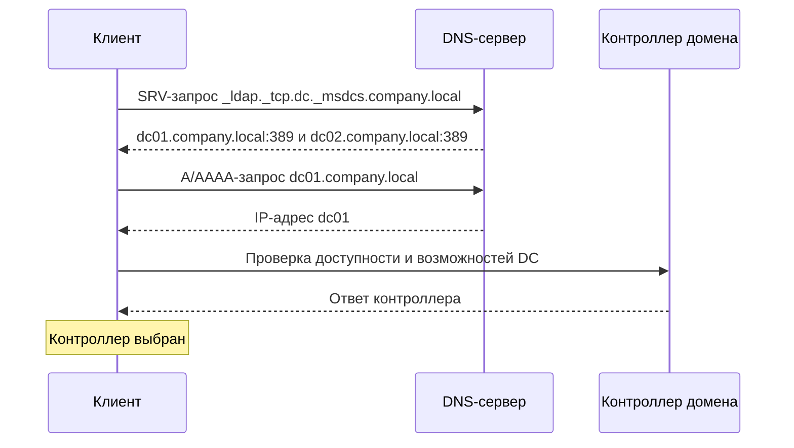
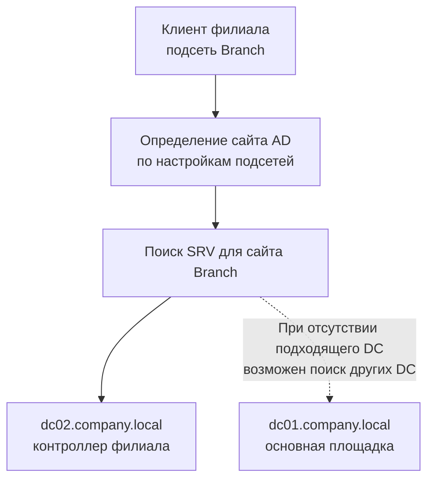
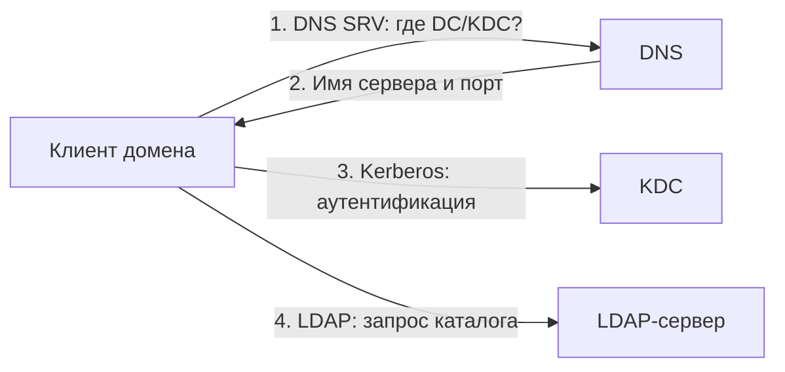

## 1. Зачем домену нужен DNS

**DNS** в доменной инфраструктуре не только преобразует имя сервера в IP-адрес. Он помогает компьютерам **находить службы домена**: контроллеры домена (DC), LDAP и Kerberos.

Например, компьютер, присоединяемый к домену `company.local`, не обязан заранее знать IP-адрес контроллера. Он обращается к DNS и получает сведения о том, где искать нужную службу.

> [!IMPORTANT] Основное различие
> **A/AAAA-запись** отвечает на вопрос «Какой IP-адрес у этого имени?». **SRV-запись** отвечает на вопрос «Какой сервер предоставляет нужную службу и на каком порту?». Для подключения обычно нужны оба шага.

## 2. Типы DNS-записей, используемые в домене

| Тип | Назначение | Пример |
|---|---|---|
| `A` | IPv4-адрес узла | `dc01.company.local → 192.0.2.10` |
| `AAAA` | IPv6-адрес узла | `dc01.company.local → 2001:db8::10` |
| `SRV` | Сервер, предоставляющий службу, и её порт | `_ldap._tcp.company.local → dc01.company.local:389` |
| `CNAME` | Псевдоним другого DNS-имени | `directory.company.local → dc01.company.local` |

Адреса `192.0.2.10` и `2001:db8::10` здесь демонстрационные, не реальные адреса сети.

**Почему одной A-записи недостаточно?** Имя `dc01.company.local` позволяет найти конкретный компьютер, но не сообщает клиенту, что этот компьютер является контроллером домена, предоставляет LDAP или Kerberos и какой порт нужно использовать.

## 3. Устройство SRV-записи

SRV-запись имеет следующую структуру:

```text
_служба._протокол.имя_домена.  SRV  приоритет вес порт целевой_сервер.
```

Пример:

```dns
_ldap._tcp.company.local.  IN SRV  0 100 389 dc01.company.local.
```

Разбор полей:

| Поле | Значение |
|---|---|
| `_ldap` | Искомая служба — LDAP |
| `_tcp` | Транспорт — TCP |
| `company.local` | Домен, в котором ищут службу |
| `0` | Приоритет: меньшие значения предпочтительнее |
| `100` | Вес для распределения выбора между записями одного приоритета |
| `389` | Порт LDAP |
| `dc01.company.local` | DNS-имя сервера, предоставляющего службу |

**Важно:** вес не означает процент нагрузки сам по себе. Он используется для взвешенного выбора между записями с одинаковым приоритетом. Реальное поведение зависит от клиента.

### 3.1. Несколько контроллеров

```dns
_ldap._tcp.company.local. IN SRV 0 100 389 dc01.company.local.
_ldap._tcp.company.local. IN SRV 0 100 389 dc02.company.local.
```

Обе записи сообщают, что LDAP доступен на двух контроллерах. Клиент может выбрать один из них, но SRV **не является балансировщиком нагрузки** и не проверяет здоровье сервера самостоятельно.

## 4. Как клиент обнаруживает контроллер домена

Рассмотрим компьютер, который пытается найти контроллер домена `company.local`.



**Как читать диаграмму:**

1. Клиент запрашивает **SRV-запись**, чтобы узнать имена подходящих контроллеров.
2. DNS возвращает имена серверов и порты, но не обязательно их IP-адреса в самой SRV-записи.
3. Клиент разрешает выбранное имя контроллера через A/AAAA-запись.
4. Клиент проверяет, подходит ли контроллер для нужной операции. В Active Directory обнаружение контроллера (**DC Locator**) может включать дополнительные DNS-запросы, сведения о сайте и LDAP-проверку контроллера через CLDAP.
5. После выбора DC клиент может использовать LDAP, Kerberos и другие доменные службы.

> [!INFO] Не каждый поиск DC одинаков
> Windows DC Locator учитывает контекст запроса: домен, сайт, необходимость глобального каталога, доступность контроллера и другие условия. Схема показывает основную последовательность, а не все варианты алгоритма.

## 5. Основные SRV-записи Active Directory

| Имя записи | Назначение |
|---|---|
| `_ldap._tcp.dc._msdcs.company.local` | Поиск контроллеров домена |
| `_ldap._tcp.company.local` | Поиск серверов LDAP домена |
| `_kerberos._tcp.company.local` | Поиск Kerberos KDC по TCP |
| `_kerberos._udp.company.local` | Поиск Kerberos KDC по UDP, если используется |
| `_ldap._tcp.gc._msdcs.company.local` | Поиск глобальных каталогов (GC) в лесу AD |
| `_ldap._tcp.<SiteName>._sites.dc._msdcs.company.local` | Поиск контроллеров определённого сайта AD |

Здесь `company.local` — условный пример. Имена с `_msdcs` и `_sites` относятся к механизмам обнаружения Active Directory; обычный LDAP-сервер не обязан публиковать все такие записи.

### 5.1. Почему отдельно LDAP и Kerberos

LDAP и Kerberos решают разные задачи:

- **LDAP** — чтение и изменение объектов каталога, поиск пользователей и групп.
- **Kerberos** — аутентификация с помощью TGT и Service Ticket.

Клиент может получить адрес контроллера по DNS, затем обращаться к нему по разным протоколам. SRV-записи позволяют найти соответствующую службу без жёстко заданного IP-адреса.

## 6. Сайты Active Directory и выбор ближайшего контроллера

В организации могут быть несколько площадок с разными IP-подсетями. В Active Directory **Site (сайт)** — логическое описание сетевой топологии, обычно связанное с одной или несколькими подсетями.

Предположим:

- `Main` — основная площадка с `dc01`;
- `Branch` — филиал с `dc02`.



**Пояснение к диаграмме:** клиент не просто выбирает первый IP-адрес из DNS. При корректной конфигурации сайтов и подсетей он может предпочесть контроллер своей площадки. Если подходящий контроллер недоступен, возможен поиск контроллера в другом сайте. Точные правила зависят от реализации и настроек AD.

**Зачем это нужно:** уменьшение задержек аутентификации и сокращение обращений через медленные каналы между площадками.

## 7. Кто создаёт SRV-записи

В Microsoft Active Directory контроллеры домена обычно регистрируют необходимые DNS-записи автоматически через соответствующие механизмы службы Netlogon и динамических обновлений DNS.

В Samba AD DC доменные DNS-записи также поддерживаются механизмами Samba; способ обслуживания зависит от выбранного DNS-бэкенда и конфигурации.

В нормальной ситуации администратору **не требуется вручную создавать все SRV-записи**. Важно, чтобы DNS-зона домена была корректно настроена, а записи контроллеров регистрировались и обновлялись.

> [!WARNING] Частая ошибка
> Указать на доменном компьютере публичный DNS-сервер вместо DNS, обслуживающего доменную зону. Публичный DNS обычно не знает внутренних SRV-записей `company.local`, поэтому поиск контроллера может завершиться неудачей.

## 8. Проверка записей DNS

### 8.1. Проверка SRV-записей на Linux

```bash
dig SRV _ldap._tcp.dc._msdcs.company.local
```

Команда показывает контроллеры домена, объявленные в DNS.

```bash
dig SRV _kerberos._tcp.company.local
```

Команда показывает серверы Kerberos.

```bash
dig A dc01.company.local
```

Команда проверяет преобразование имени контроллера в IPv4-адрес.

Если необходимо явно опросить определённый DNS-сервер:

```bash
dig @192.0.2.53 SRV _ldap._tcp.dc._msdcs.company.local
```

`192.0.2.53` — демонстрационный адрес DNS-сервера.

### 8.2. Проверка в Windows

```powershell
nslookup -type=SRV _ldap._tcp.dc._msdcs.company.local
```

Проверка обнаружения контроллера средствами Windows:

```powershell
nltest /dsgetdc:company.local
```

Первая команда проверяет DNS-данные, вторая — обнаружение DC клиентом Windows. Это **не одно и то же**: наличие SRV-записи не гарантирует, что контроллер доступен и подходит клиенту.

## 9. Типичные неисправности и их причины

| Симптом | Возможная причина | Что проверить |
|---|---|---|
| «Контроллер домена не найден» | Неверный DNS-сервер на клиенте | Настройки DNS клиента, SRV-запрос |
| SRV-запись есть, но подключение не работает | Неверная A/AAAA-запись, сеть или фильтрация | Разрешение имени, доступность нужных портов |
| Клиент выбирает удалённый DC | Ошибки в сайтах и подсетях AD | Соответствие подсети сайту, SRV-записи сайта |
| Один DC найден, другой нет | Неполная регистрация записей или репликация DNS | SRV и A/AAAA для каждого DC |
| Kerberos не работает при успешном DNS-поиске | Время, SPN, ключи или настройки Kerberos | Диагностика Kerberos отдельно от DNS |

**Порядок диагностики:** сначала проверить DNS-сервер клиента, затем SRV-записи, затем A/AAAA-записи выбранного DC и сетевую доступность. После этого переходить к диагностике LDAP или Kerberos.

## 10. Связь DNS, LDAP и Kerberos



**Пояснение:** DNS помогает найти нужные службы, но не аутентифицирует пользователя. Kerberos подтверждает личность, LDAP предоставляет операции с каталогом. KDC и LDAP-сервер часто работают на одном контроллере домена, хотя на схеме показаны как отдельные логические роли. Не каждое приложение обязано использовать и Kerberos, и LDAP.

## Вопросы для самопроверки

1. Почему для обнаружения контроллера домена недостаточно одной A-записи?
2. Какие сведения содержит SRV-запись?
3. Чем отличаются приоритет и вес SRV-записи?
4. Почему клиенту нужен A/AAAA-запрос после SRV-запроса?
5. Чем отличается DNS-обнаружение контроллера от проверки его доступности?
6. Для чего используются сайты и подсети Active Directory?
7. Почему публичный DNS на доменном клиенте может нарушить вход в домен?
8. Как отдельно проверить SRV-записи и обнаружение контроллера в Windows?

## Итоги — что было разобрано

- DNS помогает клиентам находить контроллеры и службы домена.
- SRV-записи указывают **тип службы, порт и сервер**, а A/AAAA-записи — IP-адрес сервера.
- Обнаружение DC может учитывать сайты AD, подсети и доступность контроллеров.
- DNS, LDAP и Kerberos выполняют разные задачи и используются совместно.
- При неисправностях домена диагностику часто следует начинать с DNS клиента и SRV-записей.

## Связанные заметки

- [[Synced/DevOps/Сетевое и системное администрирование/3. Доменная инфраструктура/0. Основы доменной инфраструктуры/3. LDAP — каталоги, DN, атрибуты и запросы.md|LDAP — каталоги, DN, атрибуты и запросы]]
- [[Synced/DevOps/Сетевое и системное администрирование/3. Доменная инфраструктура/0. Основы доменной инфраструктуры/4. Kerberos — архитектура и процесс аутентификации.md|Kerberos — архитектура и процесс аутентификации]]

---

## Теги

#DNS #SRV #ActiveDirectory #SambaAD #DomainController #DCLocator #LDAP #Kerberos #ДоменныеСлужбы #СетеваяИнфраструктура #ДиагностикаDNS
