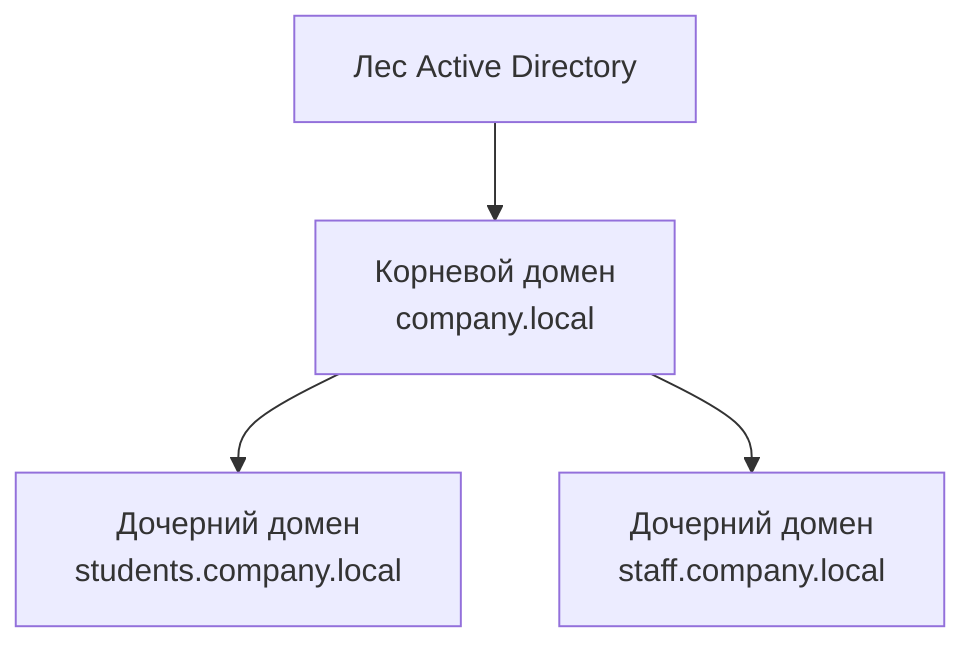
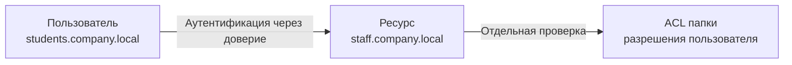
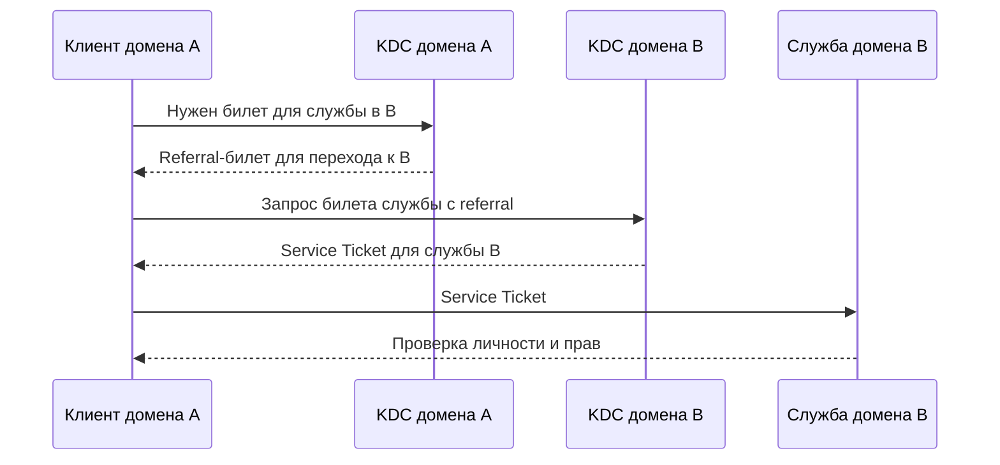
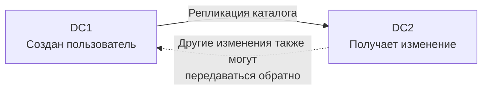
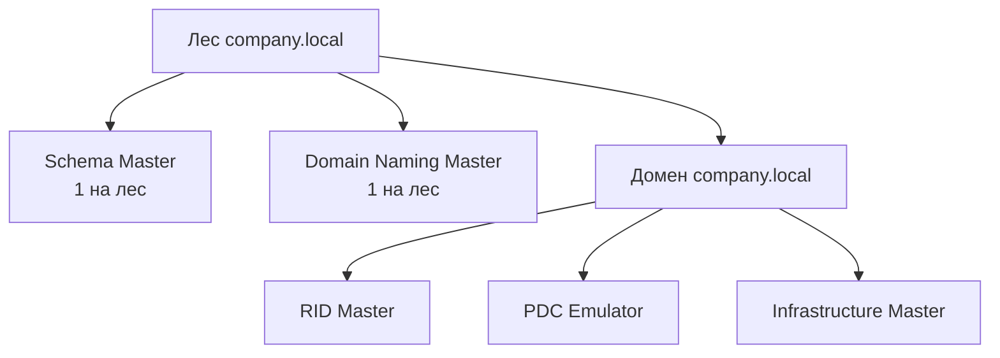
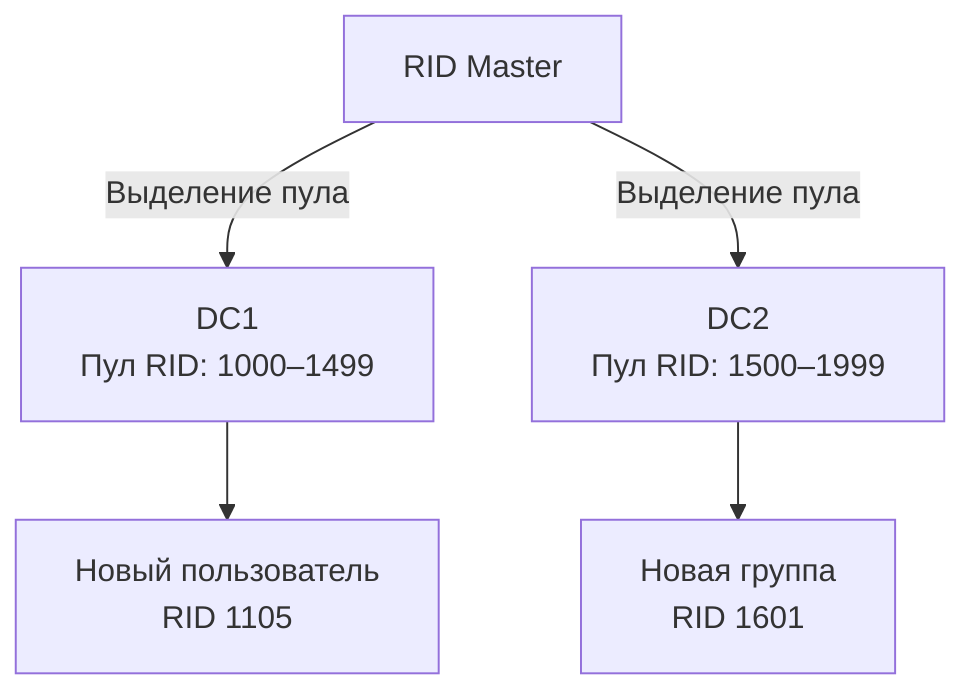

## 1. Зачем нужна структура доменов

**Домен Active Directory (AD)** — логическая область, в которой хранятся учётные записи пользователей, компьютеров, групп и другие объекты. Контроллеры домена (DC) обслуживают аутентификацию и предоставляют доступ к каталогу.

Например, в домене `company.local` могут находиться:

- пользователи `ivanov`, `petrov`;
- компьютеры `PC-01`, `PC-02`;
- серверы `FS-01`, `DB-01`;
- группы `IT-Admins`, `Teachers`.

**Домен — не то же самое, что один сервер.** Один домен может обслуживаться несколькими контроллерами, которые реплицируют данные каталога.

> [!INFO] Что уже известно из предыдущих тем
> DNS помогает клиенту найти контроллер домена; Kerberos подтверждает личность с помощью билетов; LDAP позволяет обращаться к объектам каталога. Домен объединяет эти механизмы в общую инфраструктуру.

## 2. Домен, дерево и лес

### 2.1. Домен

У домена есть DNS-имя, например `company.local`. Он содержит собственный раздел каталога с доменными объектами и может иметь несколько DC.

Домен представляет собой важную границу администрирования и репликации доменных данных. При этом **полной границей безопасности в AD обычно считают лес**, а не отдельный домен.

### 2.2. Дерево доменов

**Дерево (Domain Tree)** — один или несколько доменов с непрерывным пространством DNS-имён.

Пример:

```text
company.local
students.company.local
staff.company.local
```

`students.company.local` и `staff.company.local` здесь — **отдельные дочерние домены**, если они действительно созданы как домены AD.

> [!WARNING] Поддомен DNS не обязательно является доменом AD
> Запись `portal.company.local` или DNS-зона `students.company.local` сами по себе не создают отдельный домен Active Directory. Для этого требуется развёртывание домена с контроллерами.

### 2.3. Лес

**Лес (Forest)** — совокупность одного или нескольких доменов AD, использующих общие:

- **Schema** — определения классов объектов и атрибутов;
- **Configuration** — сведения о структуре и конфигурации леса;
- **Global Catalog** — механизм поиска объектов между доменами леса;
- доверительные отношения между доменами леса.

Первый домен при создании леса называется **корневым доменом леса** (Forest Root Domain).

Лес может включать несколько деревьев с разными пространствами имён, например `company.local` и `example.org`.



**Пояснение к диаграмме:**

1. Вверху показан один лес.
2. `company.local` — его корневой домен.
3. `students.company.local` и `staff.company.local` — отдельные дочерние домены.
4. Домены входят в общий лес, но каждый имеет собственный доменный раздел каталога.
5. Стрелки показывают иерархию, **а не сетевые соединения между DC**.

## 3. Организационные единицы (OU) и отдельные домены

**OU (Organizational Unit)** — контейнер внутри домена для организации объектов, делегирования управления и применения групповых политик.

Например:

```text
company.local
├── OU=Students
├── OU=Teachers
└── OU=Servers
```

В этом примере **всё находится в одном домене**. OU не имеют собственных контроллеров домена, отдельных FSMO-ролей или собственных доменных доверий.

| Характеристика | OU | Отдельный домен |
|---|---|---|
| Собственные контроллеры домена | Нет | Да |
| Отдельный доменный раздел каталога | Нет | Да |
| Отдельные доменные FSMO-роли | Нет | Да |
| Делегирование администрирования | Да | Да |
| Применение GPO | Да | Да |
| Дополнительная сложность | Обычно небольшая | Существенная |

**Практический вывод:** для разделения студентов, сотрудников и серверов часто достаточно одного домена с OU и группами. Отдельные домены нужны при наличии конкретных требований, которые нельзя разумно выполнить в рамках одного домена.

## 4. Доверительные отношения между доменами

**Доверительное отношение (Trust)** позволяет одному домену принимать результаты аутентификации пользователей другого домена при доступе к ресурсам.

Но доверие **не выдаёт права на ресурсы автоматически**.

### 4.1. Кто кому доверяет

Пусть:

- домен `students.company.local` содержит пользователя Иванова;
- домен `staff.company.local` содержит файловый сервер;
- администратор хочет разрешить Иванову доступ к определённой папке.

Если **`staff.company.local` доверяет `students.company.local`**, домен ресурсов может принимать аутентификацию пользователей домена студентов. Но доступ к папке всё равно определяется ACL.



**Пояснение к диаграмме:**

1. Пользователь принадлежит одному домену, ресурс — другому.
2. Доверие создаёт возможность междоменной аутентификации.
3. Файловый сервер всё равно проверяет ACL.
4. Если прав нет, доступ будет запрещён даже при работающем доверии.

> [!IMPORTANT] Направление доверия
> Формулировка «A доверяет B» означает, что **A принимает аутентификацию субъектов из B**. Направление удобно проверять вопросом: «Чьим пользователям можно дать доступ к ресурсам какого домена?»

### 4.2. Основные свойства доверий

**Одностороннее доверие (One-way Trust)** — доверие действует в одном направлении.

**Двустороннее доверие (Two-way Trust)** — обе стороны доверяют друг другу.

**Транзитивное доверие** — доверие может распространяться через цепочку доменов в пределах установленных правил. Например, если A доверяет B, а B доверяет C, транзитивная модель может позволить доверие A к C.

**Нетранзитивное доверие** — действует только между указанными сторонами.

Внутри леса AD родительские и дочерние домены автоматически устанавливают двусторонние транзитивные доверия. Между лесами возможны отдельные доверительные отношения с дополнительными ограничениями.

### 4.3. Доверие и Kerberos

При обращении к службе в другом домене Kerberos может использовать **междоменные referral-билеты**, направляя клиента к KDC нужного домена.

Упрощённая последовательность:



**Пояснение к диаграмме:**

1. Клиент сначала обращается к KDC своего домена.
2. KDC направляет его к домену, обслуживающему целевую службу.
3. Клиент получает Service Ticket от KDC целевого домена.
4. Служба проверяет билет, затем — права доступа.
5. Схема намеренно упрощена: при сложных довериях возможны промежуточные переходы, дополнительные проверки и ограничения.

## 5. Репликация между контроллерами домена

Если в домене несколько DC, они должны иметь согласованные данные каталога.

**Репликация** — обмен изменениями между контроллерами домена.

В современных AD большинство обычных изменений выполняется по **модели multi-master**: запись может быть изменена на разных записываемых DC, а затем распространена репликацией.

Например:

1. Администратор создаёт пользователя на `DC1`.
2. Изменение сохраняется на `DC1`.
3. Репликация передаёт изменение на `DC2`.
4. После завершения репликации оба контроллера видят пользователя.



**Пояснение к диаграмме:** стрелка слева направо показывает распространение конкретного изменения. Пунктирная стрелка напоминает, что обычная репликация AD не ограничивается одним постоянным направлением.

Однако некоторые операции должны выполняться **только одним контроллером в определённый момент**. Для них существуют FSMO-роли.

## 6. FSMO — зачем нужны специальные роли

**FSMO (Flexible Single Master Operations)** — пять ролей Active Directory, которые назначаются конкретным контроллерам домена.

Они необходимы для операций, где одновременное независимое выполнение на нескольких DC могло бы вызвать конфликт или нарушить согласованность.

> [!INFO] FSMO — не «главный контроллер для всех запросов»
> Наличие FSMO-ролей не означает, что остальные DC не могут аутентифицировать пользователей, отвечать на LDAP-запросы или выполнять обычную репликацию. Роли отвечают за определённые специальные операции.

### 6.1. Пять ролей FSMO

| Роль | Область | Основная задача |
|---|---|---|
| **Schema Master** | Одна на лес | Контроль изменений схемы AD |
| **Domain Naming Master** | Одна на лес | Контроль добавления и удаления доменов и некоторых объектов именования |
| **RID Master** | Одна на домен | Выдача DC пулов относительных идентификаторов RID |
| **PDC Emulator** | Одна на домен | Особая роль при обработке изменений паролей, времени и совместимости |
| **Infrastructure Master** | Одна на домен | Обновление некоторых междоменных ссылок на объекты |

Для леса с одним доменом — **всего пять ролей**.

Для леса с тремя доменами — **две лесные роли + три роли на каждый домен = 11 ролей**.

### 6.2. Лесные и доменные роли



**Пояснение к диаграмме:**

1. Две роли относятся ко всему лесу.
2. Три роли существуют отдельно в каждом домене.
3. Диаграмма показывает **область ответственности ролей**, а не шесть физических серверов.
4. Один контроллер может одновременно владеть несколькими или всеми пятью ролями.

## 7. Разбор FSMO-ролей на примерах

### 7.1. Schema Master

**Схема AD** определяет, какие типы объектов и атрибутов существуют в каталоге.

Например, класс `user` имеет набор допустимых атрибутов.

Если администратор или приложение расширяет схему AD, изменение координируется контроллером с ролью **Schema Master**.

Обычное создание пользователя **не требует** изменения схемы.

### 7.2. Domain Naming Master

Контролирует изменения состава доменов леса.

Например, при создании нового домена `students.company.local` требуется согласованное обновление структуры леса.

**Domain Naming Master** участвует в этой операции, чтобы структура доменов не оказалась противоречивой.

Создание обычной OU `Students` внутри существующего домена к этой роли не относится.

### 7.3. RID Master

Каждый объект безопасности AD, например пользователь или группа, получает **SID (Security Identifier)** — уникальный идентификатор безопасности.

Упрощённо SID доменного пользователя состоит из:

```text
SID домена + RID объекта
```

Например:

```text
S-1-5-21-111111111-222222222-333333333-1105
```

Здесь `1105` — RID объекта (числа приведены только как пример).

DC создают пользователей самостоятельно, но не должны выдавать одинаковые RID. Поэтому RID Master выделяет каждому контроллеру **свой диапазон RID**.



**Пояснение к диаграмме:**

1. RID Master распределяет **диапазоны**, а не обязательно выдаёт каждый RID отдельно.
2. `DC1` создаёт объект с RID из собственного пула.
3. `DC2` использует другой пул.
4. Благодаря разделению диапазонов не возникает одинаковых RID в пределах домена.

Если RID Master временно недоступен, DC могут продолжать создавать объекты, пока у них остаются неиспользованные RID в выделенных пулах.

### 7.4. PDC Emulator

**PDC Emulator** выполняет несколько особых функций:

- участвует в обработке недавних изменений паролей и проверке некоторых ошибок аутентификации;
- играет центральную роль в иерархии синхронизации времени Windows-домена;
- используется рядом механизмов совместимости и администрирования, в том числе при работе с групповыми политиками.

**Пример с изменением пароля:**

1. Иванов меняет пароль через `DC1`.
2. Он пытается войти через `DC2`, куда изменение ещё не успело реплицироваться.
3. `DC2` может обратиться к PDC Emulator, прежде чем окончательно отклонить аутентификацию из-за неверного пароля.

Это помогает уменьшить проблемы, вызванные задержками репликации.

> [!IMPORTANT] PDC Emulator не проверяет каждый вход
> Обычная аутентификация может выполняться на других контроллерах домена. PDC Emulator не является обязательным промежуточным сервером для всех Kerberos-запросов.

### 7.5. Infrastructure Master

Эта роль связана с обновлением определённых ссылок на объекты **других доменов**.

Например, если в группе одного домена присутствует пользователь другого домена, изменение имени или других ссылочных данных пользователя может потребовать обновления соответствующих сведений.

В современных конфигурациях её практическое значение зависит от особенностей леса, наличия Global Catalog и режима Recycle Bin. Нельзя считать, что эта роль всегда создаёт отдельную постоянную нагрузку.

## 8. Что будет при недоступности владельца FSMO

Отказ DC с FSMO-ролью **не означает автоматическую остановку всего домена**.

| Недоступная роль | Возможные последствия |
|---|---|
| Schema Master | Невозможно штатно вносить изменения схемы |
| Domain Naming Master | Проблемы с добавлением или удалением доменов |
| RID Master | После исчерпания локальных пулов RID DC не смогут создавать новые объекты безопасности |
| PDC Emulator | Возможны проблемы с некоторыми сценариями паролей, времени и администрирования |
| Infrastructure Master | Возможны задержки обновления соответствующих междоменных ссылок |

При этом другие исправные DC могут продолжать обслуживать множество обычных запросов.

### 8.1. Перенос и захват ролей

**Transfer (передача)** — плановый перенос FSMO-роли с доступного DC на другой.

**Seize (захват)** — принудительное назначение роли другому DC при недоступности прежнего владельца.

Захват требует особой осторожности: необходимо исключить неконтролируемое возвращение старого владельца роли в работу и соблюдать процедуры восстановления AD.

> [!WARNING] Не захватывать FSMO при каждой кратковременной недоступности
> Сначала определить характер отказа, состояние репликации и возможность штатного восстановления. Принудительный захват — аварийная операция.

## 9. Global Catalog (GC)

**Global Catalog** — роль контроллера домена, позволяющая выполнять поиск объектов по всему лесу.

GC содержит:

- полную копию объектов своего домена;
- частичные копии объектов других доменов леса с выбранными атрибутами.

Это полезно, когда необходимо найти пользователя или группу в другом домене леса.

GC — **не шестая FSMO-роль**. Контроллер может быть Global Catalog независимо от того, какими FSMO-ролями он владеет.

В однодоменном лесу многие различия между обычным DC и GC менее заметны, но понятие GC остаётся важным для понимания AD.

## 10. Практическая проверка ролей

### 10.1. Windows Active Directory

Просмотр владельцев FSMO:

```powershell
netdom query fsmo
```

Через PowerShell-модуль Active Directory:

```powershell
Get-ADForest | Select-Object SchemaMaster, DomainNamingMaster
```

```powershell
Get-ADDomain | Select-Object RIDMaster, PDCEmulator, InfrastructureMaster
```

Команды предполагают установленный модуль Active Directory и соответствующий доступ.

### 10.2. Samba Active Directory DC

Просмотр владельцев FSMO на контроллере Samba AD:

```bash
sudo samba-tool fsmo show
```

Команда показывает текущих владельцев ролей. В Samba AD существуют особенности реализации и управления ролями, поэтому операции переноса и захвата необходимо выполнять по документации используемой версии Samba.

## 11. Как всё связано: домен, доверие, репликация и FSMO

Рассмотрим два DC в одном домене:

- `dc1.company.local`;
- `dc2.company.local`.

Оба могут обслуживать обычные запросы Kerberos и LDAP, а данные каталога между ними реплицируются.

FSMO-роли могут находиться на `DC1`, на `DC2` или быть распределены между ними. При этом наличие всех FSMO на `DC1` **не делает `DC2` бесполезным**.

Если добавить отдельный домен `students.company.local`, у него будут собственные DC и три доменные FSMO-роли. Оба домена войдут в один лес с общими лесными ролями.

Для доступа пользователей одного домена к ресурсам другого применяются доверительные отношения и проверки прав доступа.

## 12. Типичные ошибки понимания

**«Каждому отделу нужен отдельный домен».** Нет. Для организационного разделения обычно достаточно OU и групп.

**«Домен — это контроллер домена».** Нет. Домен — логическая структура; DC — сервер, который её обслуживает.

**«Если DC не владеет FSMO, он не может аутентифицировать пользователей».** Неверно. FSMO отвечают за отдельные специальные операции.

**«Доверие автоматически разрешает доступ ко всем файлам».** Нет. Доверие позволяет использовать междоменную аутентификацию; разрешения проверяются отдельно.

**«Global Catalog — это одна из FSMO-ролей».** Нет. GC и FSMO — разные механизмы.

## Вопросы для самопроверки

1. Чем домен отличается от контроллера домена?
2. Чем OU отличается от дочернего домена?
3. Что общего у доменов одного леса?
4. Почему лес считают важной границей безопасности?
5. Что означает выражение «домен A доверяет домену B»?
6. Почему доверие не заменяет ACL?
7. Для чего нужна репликация AD?
8. Почему RID Master выдаёт диапазоны RID, а не обязательно каждый RID по отдельности?
9. Какие две FSMO-роли относятся ко всему лесу?
10. Какие три FSMO-роли существуют в каждом домене?
11. Что делает PDC Emulator при задержке репликации пароля?
12. Чем Global Catalog отличается от FSMO?
13. Чем плановый перенос FSMO отличается от принудительного захвата?

## Итоги — что было разобрано

- Домен объединяет объекты каталога и может обслуживаться несколькими DC.
- Лес объединяет домены с общей схемой и конфигурацией.
- OU предназначены для организации и делегирования внутри домена.
- Доверительные отношения обеспечивают возможность междоменной аутентификации, но не заменяют права доступа.
- Репликация синхронизирует изменения между DC.
- FSMO — пять специальных ролей: две на лес и три на каждый домен.
- Global Catalog обеспечивает поиск объектов по лесу и не является FSMO-ролью.

## Связанные заметки

- [[Synced/DevOps/Сетевое и системное администрирование/3. Доменная инфраструктура/0. Основы доменной инфраструктуры/3. LDAP — каталоги, DN, атрибуты и запросы.md|LDAP — каталоги, DN, атрибуты и запросы]]
- [[Synced/DevOps/Сетевое и системное администрирование/3. Доменная инфраструктура/0. Основы доменной инфраструктуры/4. Kerberos — архитектура и процесс аутентификации.md|Kerberos — архитектура и процесс аутентификации]]
- [[Synced/DevOps/Сетевое и системное администрирование/3. Доменная инфраструктура/0. Основы доменной инфраструктуры/5. DNS, SRV-записи и обнаружение контроллеров.md|DNS, SRV-записи и обнаружение контроллеров]]

---

## Теги

#ActiveDirectory #ДоменнаяИнфраструктура #Домены #Леса #FSMO #DomainTrust #Replication #GlobalCatalog #RIDMaster #PDCEmulator #SchemaMaster #DomainNamingMaster #InfrastructureMaster #SambaAD #LDAP #Kerberos
