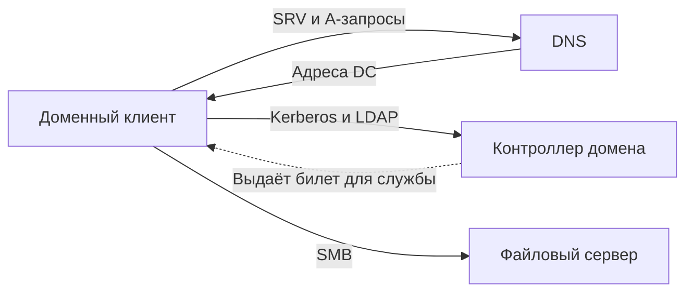
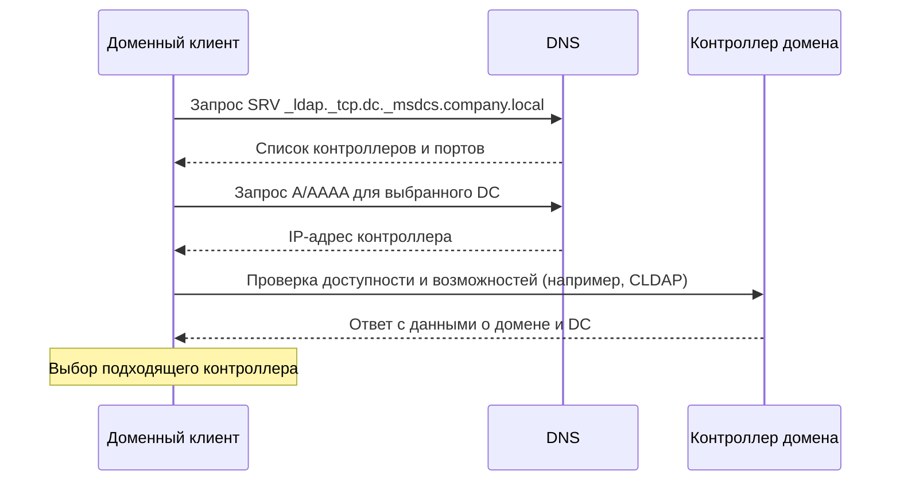
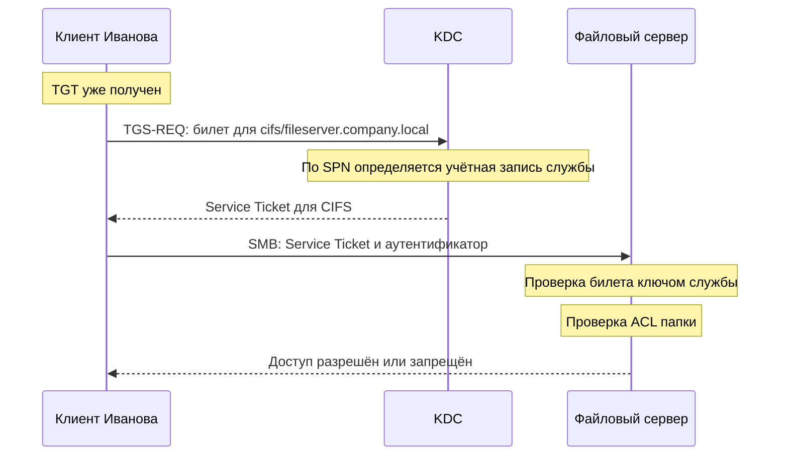
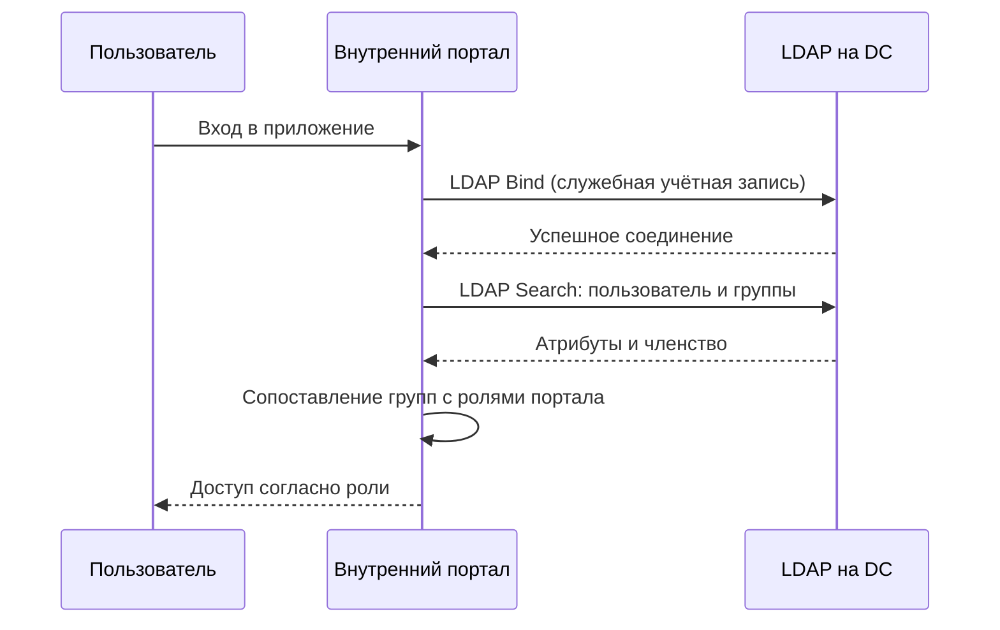
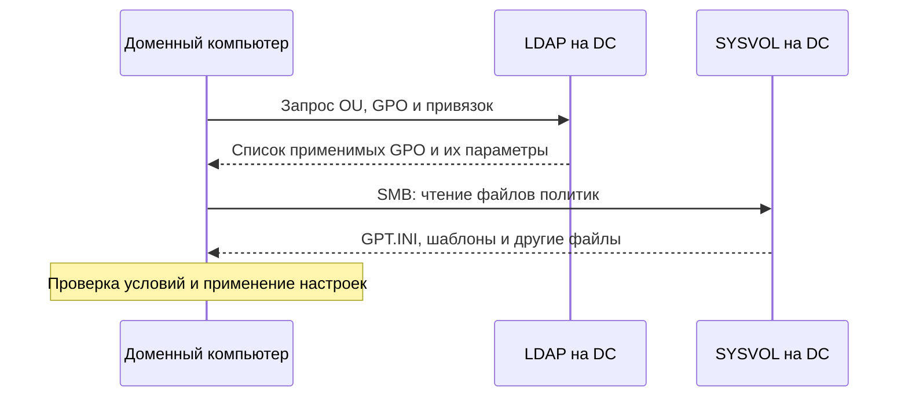
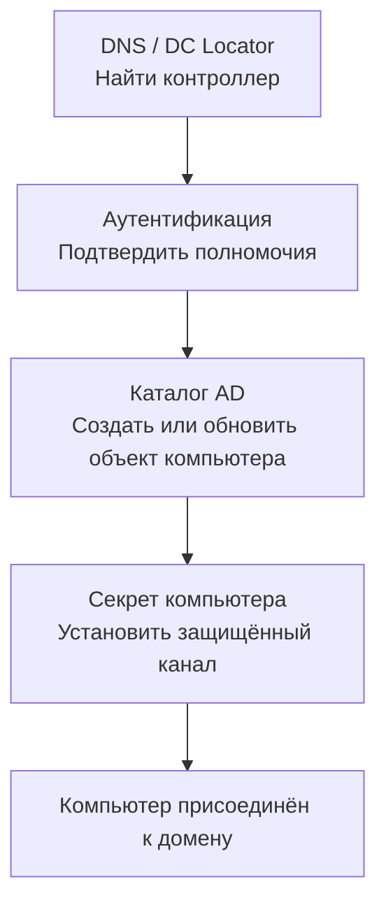
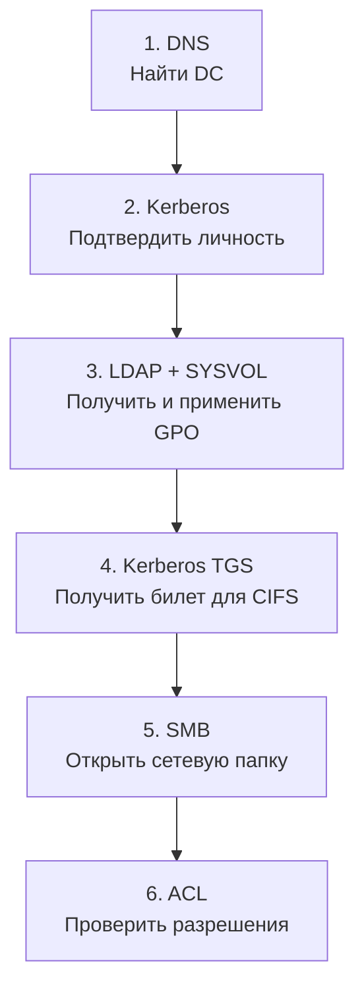

## 1. Назначение темы

Active Directory — не один сетевой протокол, а набор служб, которые совместно обеспечивают поиск контроллеров домена, аутентификацию, работу с каталогом, применение политик и доступ к ресурсам.

**Цель:** понять, какой компонент участвует в каждой операции, зачем нужен соответствующий протокол и как диагностировать сбой на определённом этапе.

В этой заметке рассматривается **взаимодействие компонентов**, а не повторяется подробная теория LDAP, Kerberos, DNS или FSMO из предыдущих тем.

## 2. Основные компоненты и протоколы

| Компонент / протокол | Основная задача | Типичные порты |
|---|---|---|
| DNS | Поиск контроллеров домена и разрешение имён | 53 UDP/TCP |
| LDAP | Поиск и изменение объектов каталога | 389 TCP/UDP (CLDAP по UDP) |
| LDAPS | LDAP поверх TLS | 636 TCP |
| Global Catalog | Поиск объектов в пределах леса | 3268 TCP, 3269 TCP (TLS) |
| Kerberos | Аутентификация с помощью билетов | 88 UDP/TCP |
| Kerberos password change | Изменение пароля через соответствующий протокол | 464 UDP/TCP |
| SMB | Доступ к общим папкам и SYSVOL | 445 TCP |
| RPC | Удалённые вызовы, часть операций AD и репликации | 135 TCP и динамические RPC-порты |
| NTP / Windows Time | Синхронизация времени | 123 UDP |

> [!INFO] Порт — не вся технология
> Открытый порт не означает, что служба корректно работает. Например, Kerberos зависит от DNS, времени, учётных записей и ключей. А доступность TCP/389 не гарантирует успешный LDAP Bind.

> [!WARNING] LDAP 389 не всегда означает передачу данных без шифрования
> На TCP/389 возможно использование **StartTLS**. Также LDAP может применять SASL с защитой целостности и конфиденциальности. Для передачи паролей следует использовать защищённый механизм и проверять требования конкретной реализации.

## 3. Как компоненты связаны друг с другом



**Пояснение к диаграмме:**

1. Клиент обращается к DNS, чтобы узнать, какие контроллеры обслуживают домен.
2. С выбранным контроллером клиент взаимодействует по Kerberos и LDAP.
3. Для доступа к файлам клиент устанавливает **отдельное SMB-соединение** с файловым сервером.
4. Контроллер выдаёт билет для файловой службы, но не передаёт через себя содержимое файлов.
5. Пунктирная стрелка показывает выдачу билета клиенту, а не прямое соединение KDC с файловым сервером.

Это **общая схема**, а не обязательный порядок для каждого запроса. Например, LDAP-приложение может работать без Kerberos, а билет службы может уже находиться в кэше.

## 4. Обнаружение контроллера домена

Клиенту необходимо узнать, к какому DC обращаться. Для этого используются DNS и механизм **DC Locator**.

### 4.1. Последовательность



**Пояснение:**

1. SRV-запись возвращает **имя сервера**, порт, приоритет и вес, а не только IP-адрес.
2. Дополнительный DNS-запрос преобразует имя DC в IP-адрес.
3. Клиент может проверить контроллер с помощью LDAP Ping через CLDAP и учесть расположение в сайте AD.
4. После выбора DC начинаются отдельные операции Kerberos, LDAP и другие обращения.
5. Конкретные запросы зависят от ОС, состояния кэша и реализации клиента; приведена типовая модель.

**Пример проверки:**

```bash
dig SRV _ldap._tcp.dc._msdcs.company.local
```

```bash
dig SRV _kerberos._tcp.company.local
```

```bash
dig A dc1.company.local
```

> [!TIP] Как интерпретировать неисправность
> Если SRV-записи отсутствуют или указывают на неправильный сервер, клиент может не найти DC даже при исправной работе LDAP и Kerberos на самом контроллере.

## 5. Аутентификация пользователя и получение билетов

После обнаружения контроллера клиент может использовать Kerberos.

**Важно различать:**

- **TGT** — билет для обращения к TGS;
- **Service Ticket** — билет для определённой службы;
- **SPN** — имя службы, по которому KDC определяет учётную запись и ключ службы.

### 5.1. Пример доступа к SMB

Пользователь `ivanov@COMPANY.LOCAL` открывает:

```text
\\fileserver.company.local\documents
```



**Пояснение:**

1. Клиент уже имеет TGT после первоначальной аутентификации.
2. По имени сервера и типу службы он формирует SPN `cifs/fileserver.company.local`.
3. KDC находит учётную запись, которой соответствует SPN, и использует её ключ при формировании билета.
4. Файловый сервер проверяет билет своим ключом и аутентификатор клиента.
5. **Kerberos устанавливает личность, но не заменяет проверку разрешений** на папку.

Если Service Ticket уже находится в кэше, новый TGS-запрос может не потребоваться.

## 6. LDAP: получение данных из каталога

Kerberos не является универсальным способом узнать отдел пользователя, адрес электронной почты или список всех его атрибутов. Эти данные хранятся в каталоге и могут запрашиваться через LDAP.

### 6.1. Пример приложения

Допустим, внутренний портал должен узнать, входит ли Иванов в группу `IT-Admins`.



**Пояснение:**

1. Портал подключается к LDAP с учётными данными, которым разрешён нужный поиск.
2. Через LDAP Search получает сведения об Иванове и его группах.
3. Сам портал решает, какие функции доступны группе `IT-Admins`.
4. На схеме **не показана проверка пароля Иванова**: она должна выполняться отдельно (например, через пользовательский LDAP Bind, Kerberos SSO или другой механизм).
5. Служебная учётная запись LDAP не обязана иметь SPN. SPN нужен в тех сценариях, где используется Kerberos-аутентификация службы.

### 6.2. LDAP и Kerberos могут использоваться вместе

Например, портал может:

1. Принять Kerberos-билет пользователя через HTTP Negotiate.
2. Подтвердить его личность.
3. Выполнить LDAP-поиск атрибутов или групп.
4. Назначить внутреннюю роль приложения.

Но это не единственный вариант: некоторые приложения используют только LDAP Bind, другие — Kerberos без дополнительного LDAP-поиска.

## 7. Как применяются групповые политики

**Group Policy (GPO)** использует несколько компонентов AD.

- В каталоге через LDAP хранятся объекты групповых политик и сведения об их привязках.
- В **SYSVOL** через SMB размещаются файловые части политик.
- Клиент определяет применимые политики и обрабатывает их соответствующими расширениями.

### 7.1. Последовательность



**Пояснение:**

1. Клиент определяет, какие политики связаны с доменом, сайтом и OU, и учитывает фильтрацию.
2. LDAP предоставляет сведения о GPO как объектах каталога.
3. SMB используется для чтения файловой части GPO из `SYSVOL`.
4. Клиент применяет настройки, если условия политики выполнены.
5. Поэтому **исправный LDAP не гарантирует работу GPO**, если недоступен SYSVOL или имеются проблемы с разрешениями.

> [!INFO] Две части GPO
> **GPC (Group Policy Container)** — объект в AD. **GPT (Group Policy Template)** — файлы политики в SYSVOL. Для корректной работы важна доступность обеих частей.

## 8. Репликация между контроллерами домена

Несколько контроллеров одного домена должны согласовывать изменения каталога.

### 8.1. Репликация каталога

В AD DS репликация каталога между DC использует, в частности, **RPC**. Она не сводится к простому копированию LDAP-запросов между серверами.


**Пояснение:** изменение, внесённое на одном записываемом DC, передаётся другому DC через механизмы репликации. Схема показывает **один конкретный поток изменений**, а не единственное направление обмена.

### 8.2. Репликация SYSVOL — отдельный механизм

**Каталог AD и SYSVOL реплицируются не одним и тем же механизмом.**

В современных Microsoft AD DS для SYSVOL используется **DFSR**. В Samba AD DC автоматическая репликация SYSVOL между контроллерами имеет иные особенности и обычно требует отдельного решения; нельзя автоматически переносить предположения о DFSR на Samba.

**Следствие:** возможна ситуация, когда LDAP-объекты GPO синхронизированы, а файловая часть политики в SYSVOL — нет.

## 9. Присоединение компьютера к домену

Присоединение компьютера — не просто добавление DNS-записи. Обычно требуется:

1. Найти контроллер домена через DNS и DC Locator.
2. Аутентифицировать учётную запись, выполняющую присоединение.
3. Создать или использовать компьютерный объект в каталоге.
4. Установить доверительные отношения между компьютером и доменом, включая секрет компьютерной учётной записи.
5. Настроить необходимые параметры DNS, Kerberos и локальной системы.



**Пояснение:**

1. Без корректного DNS клиент может не найти DC.
2. Учётная запись присоединения должна иметь необходимые разрешения.
3. Объект компьютера хранится в каталоге AD.
4. Секрет компьютерной учётной записи используется для последующего защищённого взаимодействия с доменом.
5. Конкретные команды и порядок отличаются в Windows, Samba и Linux-клиентах; здесь показаны общие этапы.

## 10. Зависимости и диагностика

При неисправности полезно проверять компоненты **в порядке зависимостей**, а не начинать сразу с переустановки доменного клиента.

| Симптом | Что проверить в первую очередь |
|---|---|
| Домен не обнаруживается | DNS-сервер клиента, SRV-записи, A/AAAA DC |
| Kerberos не выдаёт билет | Время, DNS-имя, доступность KDC, учётные данные |
| Билет выдан, но служба его не принимает | SPN, ключи службы, keytab, время |
| LDAP-поиск не работает | LDAP Bind, Base DN, фильтр, права, TLS |
| Пользователь входит, но GPO не применяется | LDAP-часть GPO, SYSVOL, SMB, фильтрация |
| На разных DC разные данные | Состояние репликации каталога |
| GPO различаются на DC | Отдельно проверить репликацию SYSVOL |

### 10.1. Проверка DNS

```bash
dig SRV _ldap._tcp.dc._msdcs.company.local
```

```bash
dig SRV _kerberos._tcp.company.local
```

### 10.2. Проверка Kerberos

```bash
kinit ivanov@COMPANY.LOCAL
```

```bash
klist
```

Запрос билета для конкретной службы:

```bash
kvno cifs/fileserver.company.local
```

### 10.3. Проверка LDAP

Пример простого поиска корневой информации каталога (RootDSE):

```bash
ldapsearch -x -H ldap://dc1.company.local -s base -b "" defaultNamingContext
```

> [!WARNING] Особенности проверки
> Анонимный RootDSE-запрос зависит от политики сервера. Неуспешный ответ сам по себе не доказывает неисправность LDAP. Для рабочих операций используйте подходящий защищённый способ аутентификации.

### 10.4. Проверка SMB / SYSVOL

На Windows:

```powershell
Test-NetConnection dc1.company.local -Port 445
```

Проверка доступности SYSVOL:

```text
\\company.local\SYSVOL
```

Доступность TCP/445 — только предварительная проверка. Далее требуется проверить SMB-аутентификацию, доступ к папке и наличие файлов.

## 11. Разбор полного сценария: вход и работа пользователя

Рассмотрим пользователя, который входит в доменный компьютер, получает политики и открывает сетевую папку.



**Пояснение к диаграмме:**

1. DNS позволяет определить контроллер домена.
2. Kerberos обеспечивает аутентификацию пользователя.
3. Для групповых политик используются данные каталога и файлы SYSVOL.
4. Для файловой службы клиент получает отдельный Service Ticket.
5. SMB обеспечивает фактический доступ к файлам.
6. ACL определяет, какие операции разрешены пользователю.

**Важно:** схема демонстрирует логическую последовательность для обучения. В реальной системе часть действий выполняется параллельно, кэшируется или повторяется позже; не все этапы обязательны при каждом входе.

## 12. Основные выводы

- DNS отвечает за поиск, но не аутентифицирует пользователя.
- Kerberos подтверждает личность, но не заменяет ACL и роли приложений.
- LDAP предоставляет доступ к объектам каталога.
- SPN связывает имя службы с учётной записью и ключом для Kerberos-билета.
- SMB используется для доступа к файловым ресурсам и SYSVOL.
- GPO зависит от двух частей: данных AD и файлов SYSVOL.
- Репликация каталога и репликация SYSVOL — разные задачи.
- Диагностику следует начинать с того этапа, на котором нарушилась цепочка взаимодействия.

## Вопросы для самопроверки

1. Почему клиенту недостаточно знать только IP-адрес контроллера домена?
2. Как DNS SRV помогает обнаружить DC?
3. Чем LDAP отличается от Kerberos?
4. Зачем клиенту SPN файловой службы?
5. Почему действительный Service Ticket не гарантирует доступ к папке?
6. Какие две части образуют GPO?
7. Почему GPO может не применяться при исправном LDAP?
8. Чем репликация каталога отличается от репликации SYSVOL?
9. Какие компоненты участвуют в присоединении компьютера к домену?
10. Почему проверка открытого порта не доказывает исправность доменной службы?

## Итоги — что было разобрано

- Основные протоколы AD и их назначение.
- Обнаружение контроллеров через DNS и DC Locator.
- Взаимодействие Kerberos, SPN и файловой службы.
- Использование LDAP для поиска пользователей и групп.
- Получение и применение групповых политик.
- Репликация каталога и SYSVOL.
- Последовательность присоединения компьютера к домену.
- Проверка типичных неисправностей по этапам.

## Связанные заметки

- [[Synced/DevOps/Сетевое и системное администрирование/3. Доменная инфраструктура/0. Основы доменной инфраструктуры/2. Active Directory — объекты, структура и службы.md|Active Directory — объекты, структура и службы]]
- [[Synced/DevOps/Сетевое и системное администрирование/3. Доменная инфраструктура/0. Основы доменной инфраструктуры/3. LDAP — каталоги, DN, атрибуты и запросы.md|LDAP — каталоги, DN, атрибуты и запросы]]
- [[Synced/DevOps/Сетевое и системное администрирование/3. Доменная инфраструктура/0. Основы доменной инфраструктуры/4. Kerberos — архитектура и процесс аутентификации.md|Kerberos — архитектура и процесс аутентификации]]
- [[Synced/DevOps/Сетевое и системное администрирование/3. Доменная инфраструктура/0. Основы доменной инфраструктуры/5. DNS, SRV-записи и обнаружение контроллеров.md|DNS, SRV-записи и обнаружение контроллеров]]
- [[Synced/DevOps/Сетевое и системное администрирование/3. Доменная инфраструктура/0. Основы доменной инфраструктуры/6. Домены, леса, доверительные отношения и FSMO.md|Домены, леса, доверительные отношения и FSMO]]

---

## Теги

#ActiveDirectory #ДоменнаяИнфраструктура #DNS #SRV #DCLocator #Kerberos #SPN #LDAP #SMB #SYSVOL #GPO #RPC #Репликация #Аутентификация #SambaAD #WindowsServer #Troubleshooting
